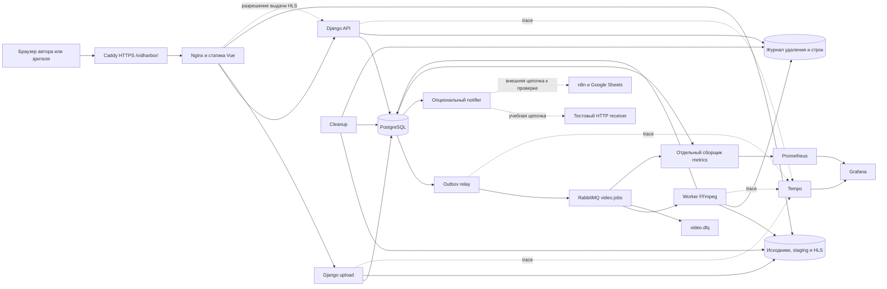
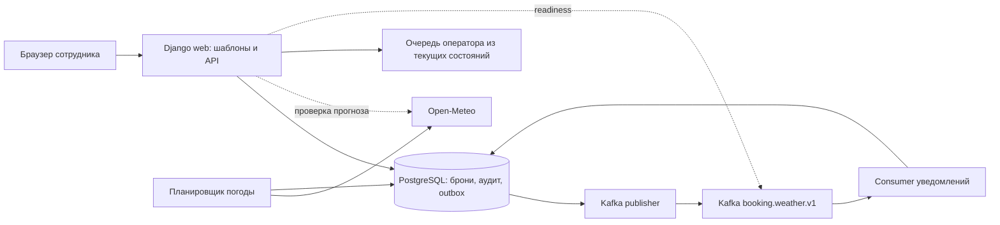

# Технический аудит Homework №005

**Дата сверки — 19 ноября 2026, МСК.** Проекты **VidHarbor** и **KazanCourts**, владелец репозиториев `ruiskhakov2017-sys`. Отчёт предназначен для ментора, который впервые видит проекты, и для подготовки владельца к устной защите.

**Видеосервис работает публично. ДЗ №005 в целом ещё открыто.** У VidHarbor подтверждены загрузка, асинхронная обработка через настоящий RabbitMQ, публичный HLS, изоляция авторов и учебное восстановление. Отправитель webhook и дедупликация проверены с учебным HTTP-получателем. Интеграция с реальными n8n и Google Sheets не подтверждена. У KazanCourts текущий `main` прошёл практику P01–P05 и регрессию с реальной Kafka. Для него ещё нужны P06–P13. Самостоятельное понимание владельца, Defense и итоговый review ментора требуют отдельных доказательств.

## 1. Статус проектов и источники

### Что считалось доказательством

- **PASS** означает, что данное требование подтверждено фактической проверкой в указанной среде. Исторические проверки сохраняют свой SHA или атрибуцию и дату. **PARTIAL** означает, что подтверждена только часть обязательного результата. **FAIL** используется, если проверка опровергла критерий или обязательная функция отсутствует в проверяемом срезе. **NOT VERIFIED** означает, что существенное утверждение нельзя подтвердить по доступным источникам. Для исторических прогонов без даты уточнение приведено прямо в таблице.
- Сверены код, Compose и конфигурации, Git и PR, API GitHub Actions, журналы и машиночитаемые артефакты. При аудите выполнены только публичные HTTP-запросы GET, чтение GitHub и статическая проверка локальных материалов. Полные CI, fault-тесты, backup/restore, запись видео в production и вызовы внешних интеграций в ходе аудита не запускались.
- Канон задания — `Mentor_Homework_005.md`, редакция 2 от **6 ноября**. Она содержит реестр M01–M34, письменный Production Practice и критерии Q/F. Письменные 11 пунктов содержат составные пары health/readiness и backup/restore. Отсюда 13 проверяемых P-критериев. Roadmap определяет Track A/B/C и контекст CP4/CP5. [Канон §3–§5][mentor] · [Roadmap][roadmap]
- Для VidHarbor дополнительно сверены PRD 0.3, DEC-001–005, задачи и матрица. Граница 720×1280 для портретного видео, отсутствие upscale, типы контейнеров, 5 ГиБ и n8n/Sheets конкретизированы проектом. Рабочие копии полной оригинальной транскрипции и видео занятия, отдельный файл `DZ5_New_Video_Project_Practical_Spec_RU.md`, Addendum, актуальные `Mentor_Progress`, Review 01 и протокол защиты №005 в просмотренных источниках не обнаружены. Сверка буквальна для доступного канона и PRD. Самостоятельная дословная сверка со всеми первичными материалами остаётся за пределами доказанного. [PRD][prd] · [Decision Log][decisions] · [Матрица VidHarbor][vtm]

### Срез Git, незавершённые изменения и приёмка

| Срез | Факт на дату аудита | Граница |
|---|---|---|
| VidHarbor GitHub `main` | `e7f513bd2443d3684b7e732ebb882548b9625f46`, merge PR №13. Ветка `feature/demo-portal` тестировалась на `8b1ff7329713385516f82ee7eea5131b09a73b80`. Сравнение дерева подтверждает совпадение этого head с деревом merge. | Push CI на merge отдельно прогнал Django. Проверки Compose и S07 ссылаются на PR head. [PR 13][v13] · [Django merge][v-main-ci] |
| VidHarbor локально | `/workspace/vidharbor-demo-portal`, `feature/demo-portal`, `8b1ff73`, на один merge-коммит позади `origin/main`. Незакоммичена ранее подготовленная версия `.github/workflows/server-connectivity.yml`. В отдельной первоначальной копии `/workspace/vidharbor` есть историческая локальная работа S06 на `118397e` и незавершённое слияние с `2c451b0` (25 строк porcelain в момент чтения). | Аудит продукта опирается на снимок `main`, а не на рабочие правки. Старые копии сохранены. |
| Ветки выпуска VidHarbor | `deploy/vidharbor-portfolio` на `ed588a8` содержит транспорт и smoke для выкладки. `diagnostic/vidharbor-https-routes` на `f85dfb9` содержит отдельную диагностику. Открытых PR — 0. Review-ветки являются пакетами доказательств. | Приложение выложено из `e7f513b`. Скрипт выпуска на отдельной ветке и конфигурация Caddy на сервере не входят в `main`. [Публикация][v-deploy] · [Ветка выпуска][v-deploy-src] |
| VidHarbor на сервере | HTTPS `/vidharbor/` на `axyro.tech`. Включена гостевая студия, `live` и `ready` OK, `postgres=true`, `rabbitmq=true`. Публичный `/internal/metrics` отдаёт 404. Во время аудита каталог пуст. Общий Portfolio readiness отвечает 200. | Пустой каталог согласуется с удалением тестовых роликов. `ready` не доказывает работающий notifier, свежесть backup или production dashboard. [Демо][demo] · [Deployment][v-deploy] · [Браузер][v-browser] |
| KazanCourts GitHub и локальный снимок | `main` `ef412f7c87c694512eb365f2a31439a46656aebc`, чистая временная копия, PR №19 merged, открытых PR — 0. `feature/hw05-kazancourts-production` на `463987f` — head влитого PR, `review/hw05-kazancourts-p01-p05` — пакет review, не новая реализация P06–P13. | На `main` доказан hosted Compose CI. Доказательства внешней выкладки этой версии KazanCourts не представлены. [PR 19][k19] · [CI main][k-ci] |
| Приёмка | У VidHarbor PR №9 и №11 объединены после технических исправлений, PR №13 merged с успешными checks и без записей review в API PR. У KazanCourts результаты независимой технической сверки отражены в документах, а PR №19 merged. | GitHub merge и технический review сами по себе не подтверждают формальную приёмку Homework ментором. [История VidHarbor][v-commits] · [KazanCourts CI review][k-ci-doc] |

В VidHarbor изменения S01–S03 вошли через PR №2–4. S04, rename и supervisor — через №5–8. S05/S06 и учебный S08 вошли через №9. Публичный интерфейс, S07, транспорт диагностики и подпуть/гостевая студия — через №10–13. Пометки «S07 ещё не опубликован» и «GitHub Not Run» в старых отчётах относятся к моменту записи. Обратная оговорка тоже важна: последующая публикация не превращает старый лабораторный restore в restore production. [История main][v-commits] · [Тестовые протоколы][v-protocols]

**Назначение.** VidHarbor превращает исходное видео автора в публичный адаптивный поток и ставит доставку уведомления после READY. На демо можно войти гостем, в исходном режиме остаётся учётная запись. KazanCourts поддерживает рабочее место сотрудника кортов: расписание, клиенты, создание/перенос/отмена/архив броней, историю, погоду для открытых кортов, состояния покрытия и очередь ситуаций для оператора. Существующая цепочка Kafka заканчивается сохранённой имитацией уведомления. Рефакторинг её бизнес-поведения и добавление Kafka DLQ в старом проекте исключены из №005 ментором. [Видеоспецификация][prd] · [Требования кортов][k-req] · [Канон §2][mentor]

## 2. Архитектура

### VidHarbor

| Компонент и реализация | Вход → обработка → выход и данные | Отказ и граница |
|---|---|---|
| Caddy, Nginx, Vue и hls.js. `config/deployment/vidharbor-path.caddy.example`, `web/default.conf`, `web/src/{main,public-videos,api,themes}.ts` | Caddy принимает HTTPS, снимает подпуть перед проксированием, передаёт только cookies VidHarbor под своим маршрутом. Nginx раздаёт сборку Vite, отправляет обычный API и поток upload разным upstream. Vue управляет формой, прогрессом и собственными роликами, показывает каталог. Hls.js загружает master, вариант и сегменты. | Ошибка Caddy блокирует внешний URL, при этом контейнеры могут жить. Совместный origin с Portfolio требует проверки изоляции cookies и маршрутов. Nginx не отдаёт raw upload или внутренние пути статикой. |
| Django API/auth. `api/vidharbor/{accounts,urls,settings,videos,public_videos,health,safety}.py` | Проверяет вход, владельца и CSRF. Автор управляет `Video`. Гостевая студия создаёт отдельного автора. Публичный каталог показывает READY с активной публикацией, чтение HLS проверяет состояние и поколение. API возвращает Nginx `X-Accel-Redirect` к защищённому файлу. | При отказе PostgreSQL управление и авторизованная выдача недоступны, `ready` 503. При restore-mode доступ закрыт. Нельзя отозвать байты, которые зритель уже получил. |
| Django upload. `uploads.py`, `media_probe.py`, `storage.py` | Принимает ожидаемый размер и бинарный PUT. Пишет временный файл потоком с хэшем и проверками длины/диска. Complete проверяет вход ffprobe, сохраняет оригинал, создаёт `Video`, `Job` и `Outbox`. | Обрыв не ставит job, пользователь повторяет передачу. HDD/media недоступны — операция отказывает, каталог в другом сервисе. Необходима очистка сирот и восстановление после сбоя на границе FS/БД. |
| PostgreSQL и migrate. `models.py`, `migrations/0001…0006`, `compose.yaml` | Хранит пользователей, сессии, загрузки, видео, поколения/попытки, outbox, READY и доставку, allocator и данные тестового получателя. Отдельный migrate подготавливает схему перед стартом зависимых сервисов. | Транзакция не охватывает брокер и файловую систему. Потеря тома требует dump/restore. Медиа нужны отдельно. Нельзя трактовать успешную миграцию как гарантию совместимости обратного отката. |
| Relay и RabbitMQ. `management/commands/relay_outbox.py`, `config/rabbitmq-entrypoint.sh` | Relay выбирает созревший outbox, публикует с обязательной маршрутизацией, persistent delivery, publisher confirm. `video.jobs` и `video.dlq` — durable quorum queues. Брокер сохраняет доставки. Источником бизнес-состояния остаётся БД. | При пропаже подтверждения или сбое после confirm relay может повторить сообщение. Один узел не даёт HA даже при типе quorum. См. раздел 5. |
| Worker и FFmpeg. `job_consumer.py`, `job_attempts.py`, `transcode.py`, `publication.py` | Проверяет схему команды и соответствие job/generation, берёт файловую/БД блокировки, кодирует HLS в staging. Проверяет структуру и manifest, публикует поколение, записывает READY и событие, подтверждает доставку. | Падение на промежуточной стадии оставляет unacked доставку либо записанное продолжение. Неполная папка не становится публичной. Блокировка защищает от одновременно работающего осиротевшего FFmpeg. |
| Cleanup и журнал. `deletion.py`, `journal.py`, `management/commands/{cleanup_uploads,recovery}.py` | Durable журнал сохраняет intent удаления и закрепление строки. Cleanup применяет неприменённое удаление, дожидается безопасной блокировки и чистит оригинал/staging/HLS. | Если запись журнала пережила rollback БД, сверка закрывает активную запись. Если журнал утерян вместе с машиной, старая копия сама не содержит более свежего удаления. |
| Notifier, HTTP-получатель. `notifications.py`, `webhook_transport.py`, `management/commands/{notify_ready,test_ready_receiver}.py`, `config/integrations/` | Закрепляет `sheet_row`, подписывает snapshot READY, откладывает повторы, принимает точный ACK от получателя. Тестовый receiver имитирует запись и конфликт. | Ошибка получателя оставляет видео доступным и не заносит новую задачу FFmpeg. Настоящий n8n/Sheets требует живой конфигурации и проверки. |
| OpenTelemetry, metrics, Prometheus, Tempo, Grafana. `telemetry.py`, `metrics.py`, `metrics_sampler.py`, `compose.observability.yaml`, `config/observability/` | Watch/API и worker дают JSON-логи, метрики и spans. Отдельный ограниченный коллектор строит snapshot по DB/AMQP, Prometheus считывает по protected endpoint, Grafana показывает dashboard, Tempo хранит trace. | Остановка Tempo или зависание метрик не должны останавливать основную цепочку. Сам профиль опциональный. Деплой панели на публичной машине независимо не подтверждён. |
| Backup/recovery. `scripts/{s08,verify_restore,test_s08}.py` | Freeze writers, PostgreSQL dump и копии данных, manifest с хэшами, экспорт актуальной authority. Восстанавливает в другой проект, применяет watermark, reconcile и только потом открывает доступ. | Ошибки manifest, scope и свежести authority должны остановить открытие. Доказанный вариант лабораторный. Утверждённого независимого носителя нет. |

Источники архитектуры и точек входа. [Compose VidHarbor][vc] · [Код API][vapi] · [Nginx и frontend][vweb] · [Telemetry profile][vobs] · [Инструкции restore][vbackup]

### KazanCourts

| Компонент и реализация | Вход → результат и состояние | Отказ и граница |
|---|---|---|
| Django web и операторский интерфейс. `config/{urls,views,settings}.py`, `templates/`, `bookings/{urls,api,forms,validators,services}.py`, `static/` | Сотрудник под сессией запрашивает расписание или изменяет бронь. Авторизация, CSRF и формы. Сервис проверяет клиента, доступность покрытия, дату/время и пересечение, возвращает JSON и историю. Оператор видит погодную очередь и фиксирует действия. | Защита от конфликтов в БД, а не только в JS. При недоступной БД редактирование и чтение не готовы. Этот Compose использует учебный runserver. |
| PostgreSQL и миграции. `bookings/models.py`, `bookings/migrations/`, `compose.yaml`, `docker/postgres/` | Сохраняет `Court`, `Customer`, `Booking`, `BookingEvent`, `WeatherIntegrationStatus`, `OutboxMessage`, `SimulatedNotification`. Операции используют транзакцию, блокировки строк, ограничение PostgreSQL от пересечения активных броней одного корта. | При конкурентной записи победившая сохраняется, конфликт возвращается пользователю. Отдельные роли приложения и тестов. Alpine и исторический Debian томы разделены, перенос не проверен. |
| Погода и scheduler. `weather_client.py`, `weather_policy.py`, `weather_health.py`, `weather_scheduler.py`, `weather_transitions.py`, `management/commands/{check_weather,schedule_weather}.py` | Читает Open-Meteo, выбирает будущие активные outdoor брони, вычисляет погодные блоки по времени Казани, сохраняет актуальное состояние/историю и outbox только для определённых переходов. Scheduler использует advisory lock и учёт следующей допустимой попытки. | Если прогноз неизвестен, прежнее надёжное состояние не затирается автоматически. Отдельные правила ручной операции покрытия. CI подставляет прогноз, реальный внешний API в последнем CI не тестирован. |
| Kafka publisher и брокер. `bookings/kafka_pipeline.py`, `management/commands/publish_weather.py` | Читает непомеченный outbox по PK под advisory lock, проверяет payload, отправляет `booking.weather.v1` с ключом booking ID и `acks=all`. После ACK ставит `published_at`. | Брокер может быть недоступен при живом web. При сбое отправки исходная строка сохраняется. Невалидная головная строка останавливает batch. |
| Kafka consumer. `kafka_pipeline.py`, `management/commands/consume_weather.py` | Проверяет полученное событие по оригинальному outbox, блокирует бронь, подавляет устаревшее или пишет одну `SimulatedNotification`, затем коммитит точный offset. | Повтор после DB commit безопасен по уникальной записи. Ошибка до commit оставляет сообщение для повторной доставки. Poison record блокирует продвижение в той же partition, DLQ отсутствует по границе №005. |
| Checks и CI. `config/{health,test_health}.py`, `.github/workflows/ci.yml`, `scripts/{check_production,ci_production}.py` | Liveness проверяет Django, readiness читает PostgreSQL и metadata Kafka. CI поднимает чистый Compose, мигрирует, делает smoke и проверки отказа, запускает тесты, аудит и cleanup. | Ready 503 сигнализирует неполную готовность. Автоматическую перестройку маршрутизации или restart unhealthy контейнера он не выполняет. Logs/trace/metrics/dashboard уровня №005 отсутствуют либо неполны. |

[Код KazanCourts][k-code] · [Compose KazanCourts][kc] · [Протокол эксплуатации][kops] · [Технический CI][k-ci]

## 3. Два полных сценария

### VidHarbor — от файла до READY и доставки

1. Посетитель открывает студию. Префикс `/vidharbor` живёт в публичных ссылках, API получает пути без префикса. `GET /api/auth/session` возвращает данные режима/CSRF. `POST /api/auth/guest` при разрешённой студии выделяет сессию автора. В классическом режиме доступны регистрация и вход. Зритель открывает каталог без сессии. [Маршруты и auth][vapi]
2. `POST /api/uploads` проверяет автора, название, размер и свободное место, создаёт Upload. `PUT /api/uploads/{id}/content` идёт через Nginx к upload; XHR обновляет прогресс, Nginx передаёт поток без полного буфера запроса, сервер пишет части и сверяет длину, хэш и блокировку. Догрузки с произвольного offset нет. [Upload][v-upload]
3. `POST /api/uploads/{id}/complete` проверяет медиа ffprobe, фиксирует исходник и postgres-транзакцию с Video/Job/Outbox. Повтор после потерянного ответа читает уже открытый Job, не создавая вторую обработку. На этом этапе ответ не ждёт перекодирования. [Upload][v-upload]
4. Relay берёт готовый outbox и отправляет команду `video.transcode.v1` в RabbitMQ. После confirm отмечает доставку. Worker с prefetch=1 получает `job_id`, `video_id`, `generation`, `next_attempt_no` и AMQP message ID. Сообщение не содержит гигабайты оригинала. При подтверждённой записи результата job ack завершает доставку. [Relay][v-relay] · [Worker][v-worker]
5. FFmpeg создаёт master HLS, variants и сегменты в staging. Для подходящего исходника есть ступени 360/480/720, горизонтальная рамка 1280×720 и вертикальная 720×1280 с учётом ориентации. Малый исходник не растягивается. Manifest и active generation отличают полную публикацию от промежуточной. Worker сохраняет READY и outbox `video.ready`. [Публикация][v-publish]
6. Каталог включает только активное READY. Есть разные адреса `/watch/{id}` для зрителя и `/media/{id}/master.m3u8` для плеера, оба с внешним mount path. При запросе варианта/сегмента Django проверяет актуальное поколение и отзыв, а Nginx читает файл по внутреннему маршруту. [Публичная выдача][v-public] · [Nginx][vweb]
7. Отдельный notifier берёт сохранённый READY-снимок, назначает номер строки, делает подписанный POST с ID, UTC-временем, названием и публичным плейлистом. Реальная учебная репетиция выполнялась с тестовым HTTP-получателем. В целевой интеграции n8n должен подтвердить только принятую Google Sheets запись и не вставлять дубликат при повторном POST. [Контракт и rehearsal][vrehearsal] · [Notifier][v-notify]

### KazanCourts — от брони до события

1. Сотрудник входит и открывает расписание. Запрос `POST /api/bookings/` проходит CSRF, проверку прав и формы. `create_booking` готовит контекст прогноза, а в транзакции повторно проверяет выбранный корт, время и конфликт. Создаются Booking и BookingEvent. Перенос, отмена, архив и состояние покрытия имеют отдельные маршруты и историю. Создание брони само по себе не обязано публиковать погодное Kafka-событие. [Сервисы бронирования][k-book] · [Требования][k-req]
2. Scheduler запускает погодный цикл, а advisory lock позволяет исполнять только один. Получает forecast, определяет будущие outdoor брони, сопоставляет интервалы с погодными блоками в зоне Казани. При применении статуса повторно под блокировкой проверяет даты, актуальность прогноза, статус и покрытие. Неизвестный результат не создаёт событие готовности. [Планировщик][k-weather]
3. Значимый переход `weather_blocked`/ `weather_cleared` атомарно обновляет бронь и создаёт `BookingEvent` + `OutboxMessage`. Publisher берёт outbox, сериализует версионированный envelope, Kafka key равен booking ID. ACK Kafka предшествует отметке публикации. [Переходы][k-transition] · [Kafka][k-pipeline]
4. Consumer сравнивает сообщение с DB snapshot, блокирует бронь и отсекает устаревшие уведомления после переноса, отмены или более позднего изменения. Сохраняется единственная запись simulated/suppressed, затем offset конкретной записи. Оператор в UI видит очередь, историю и может записать «Не дозвонились». UUID запроса предотвращает дубль этого отдельного действия. Здесь нет требования реально отправлять SMS. [Kafka][k-pipeline] · [Исходное задание §2][mentor]

## 4. Буквальная сверка требований

### P01–P13 по каждому приложению

Здесь PASS относится к минимальному критерию Homework на воспроизводимом учебном стенде. В колонке «остаток» отдельно отражено, что нужно для более сильного утверждения о production. Число 13 относится к каждому приложению. [Письменный критерий и интерпретация][mentor]

| ID и обязательный результат | Проект | Реализация и способ проверки | Доказательство и статус | Что осталось |
|---|---|---|---|---|
| P01. Запустить целое приложение через Compose | VidHarbor | `compose.yaml` поднимает Nginx, API, upload, migrate, DB, брокер, worker, relay, cleanup. Отдельные профили для наблюдения и notifier. S01 поднимает стек с нуля, S07 включает telemetry, выпуск проверил существующий Compose. | **PASS** [S01][v-s01-ci] · [S07][v-s07-ci] | Отдельно проверить реального получателя для FR-011–012. |
| P01 | KazanCourts | `compose.yaml` запускает web, migration gate, DB, Kafka и три фоновых процесса. Hosted test делает fresh up, down/up с томами и проверяет сохранение seed. | **PASS** [CI][k-ci] | Добавить к воспроизводимому сценарию будущие средства P06–P10. |
| P02. Назначение параметров и смена среды без правок кода | VidHarbor | `.env.example`, `api/vidharbor/settings.py`, deployment overlay. Port, пути, upload/FFmpeg лимиты, профиль и origin задаются отдельно; Vite получает base path при сборке. S07 валидирует публичные шаблоны, реальный выпуск меняет host/base path и включает студию. | **PASS** [Конфигурация][vc] · [CI][v-s07-ci] · [Выкладка][v-deploy] | Переезд проверялся лабораторно через корень и подпуть. |
| P02 | KazanCourts | `.env.example`, `scripts/init_local_env.py`, `config/settings.py`. Настройки DEBUG, hosts, очередь и погодные переключатели. Проверены runtime overrides, отдельные project и test role. | **PASS** [Operations][kops] · [CI][k-ci] | Утвердить production окружение, если потребуется внешний выпуск. |
| P03. Секреты отдельно, безопасные примеры и проверка заявленного объёма | VidHarbor | Compose file secrets для DB, Django, RabbitMQ, webhook и telemetry. Делается чтение из файлов/путей, шаблоны с placeholders, временные файлы CI и проверки перед выгрузкой артефактов. Выпуск получает секреты из GitHub Actions и с хоста раздельно. | **PASS** для проверенного набора, без утверждения о всей истории [Compose][vc] · [CI][v-s07-ci] · [Выкладка][v-deploy] | Отдельный узкий deploy credential и ротация широкой учётной записи — задачи эксплуатации. |
| P03 | KazanCourts | Генератор локального runtime env, игнорируемый файл, CI на одноразовых значениях. `scripts/audit_local_secrets.py` и `ci_production.py` проверяют заявленные файлы и image layers, scope upstream Kafka ограничен временными значениями. | **PASS** [CI][k-ci] · [Границы аудита][k-test] | Env виден администратору Docker. История и внешний secret manager вне доказанного объёма. |
| P04. Liveness без подмены готовности | VidHarbor | `health.live` отвечает без DB/AMQP, Compose использует healthcheck процесса. S01 удерживает live 200 при отказе, публичный GET live 200 в этом аудите. | **PASS** [Checks][v-health] · [S01][v-s01-ci] | Проверить политику рестарта в эксплуатационном сценарии при необходимости. |
| P04 | KazanCourts | `config/health.py`, `test_health.py`. GET/HEAD, no-cache, live 200 при выключенных DB/Kafka. | **PASS** [CI][k-ci] · [Протокол][k-test] | Совместить с будущим production web, если меняется сервер. |
| P05. Обязательные зависимости и переход неготовность → восстановление | VidHarbor | `ready` проверяет PostgreSQL и RabbitMQ. Отдельные probes для worker/relay при профиле. S01/S07 проигрывают отказ/возврат. Публичное ready 200, обе зависимости true. | **PASS** [S01][v-s01-ci] · [S07][v-s07-ci] | Readiness не измеряет лаг, место, статус n8n или свежесть backup. |
| P05 | KazanCourts | `SELECT 1` и Kafka cluster metadata с timeouts. `check_production.py` поочерёдно выключает DB/broker и проверяет возврат 200 после 503 при live 200. | **PASS** [CI][k-ci] · [Код и команды][kops] | Нет общего hard deadline для уже зависшей SQL-сессии и нет мониторинга lag. |
| P06. Структурированные события с временем, уровнем, сервисом и ошибкой | VidHarbor | JSON formatter и контекст в `telemetry.py`, журналы API, relay и worker. S07 проверяет поля, privacy allowlist и измеряет ротацию. | **PASS** [S07][v-s07-ci] · [Протокол][vs07] | Продемонстрировать тот же поиск в выбранной среде защиты. |
| P06 | KazanCourts | Обычные Python логгеры и DB-аудит бизнес-событий, пример `bookings/kafka_pipeline.py` и команды. Общего формата с обязательными полями по цепочке нет. | **FAIL** как критерий Homework [Код][k-code] · [Границы этапа][kp] | Ввести JSON-формат и показать реальные успех и сбой без PII. |
| P07. Связь request/job через очередь | VidHarbor | `telemetry.py` и envelope outbox связывают request, upload, job, video, message и trace IDs. В S07 один upload прослежен от передачи байтов до worker. | **PASS** [S07][v-s07-ci] · [Протокол][vs07] | Сохранить безопасный ответ на вопрос, какой ID использовать при retry. |
| P07 | KazanCourts | `booking_id` и UUID outbox связывают DB и Kafka. `contact_request_id` дедуплицирует один HTTP endpoint. Входной HTTP ID сквозь погодный сценарий и команды не подтверждён. | **PARTIAL** [Kafka][k-pipeline] · [Код][k-code] | Определить корень фонового цикла и переносить context до consumer. |
| P08. Реальная сквозная трасса этапов и длительностей | VidHarbor | OpenTelemetry HTTP/byte transfer, complete, Outbox, RabbitMQ, worker, FFmpeg и READY. Persisted trace context; CI проверил trace continuity и запрос в Tempo. | **PASS** [S07][v-s07-ci] · [Trace evidence][v-s07-art] | Трасса реального n8n вне доказанного сценария. |
| P08 | KazanCourts | В `main` нет instrumentation/exporter или сохранённой end-to-end trace. Связанные события и ID не содержат span tree. | **FAIL** [Код][k-code] · [CI scope][k-ci] | Записать spans реального погодного перехода, publish и consume с временами. |
| P09. Живые базовые измерения успеха и отказа | VidHarbor | `metrics.py`/sampler, отдельный scrape token, API latency/errors, очередь, jobs, DLQ, обработка, доставка. S07 проверил изменения, timeout collector и доступность каталога. | **PASS** [S07][v-s07-ci] · [Конфигурация][vobs] | Наблюдение в постоянно работающем публичном окружении не подтверждено. |
| P09 | KazanCourts | Readiness и persisted weather status дают разовые сведения. Базовых метрик с сериями и проверенным изменением нет. | **FAIL** [Checks][khealth] · [P01–P05 scope][kp] | Дать метрики HTTP, scheduler, outbox/consumer и проверить при сбое. |
| P10. Рабочая панель с показателями | VidHarbor | Grafana provisioned datasource и dashboard из `config/observability/`. S07 проверил реальный запрос и визуализацию Chrome. | **PASS** на CI [S07][v-s07-ci] · [Артефакт][v-s07-art] | Публичный деплой не доказывает наличие действующего production dashboard. |
| P10 | KazanCourts | Операторская очередь и weather health UI решают бизнес-задачу. Настроенной панели мониторинга с живыми метриками нет. | **FAIL** [Код][k-code] · [Границы этапа][kp] | Показать KazanCourts в своей или общей панели с раздельными метками. |
| P11. Настоящий PostgreSQL dump | VidHarbor | `scripts/s08.py backup`, freeze writers, `pg_dump -Fc --no-owner`, холодный RabbitMQ, media, manifest и watermark. Машинное evidence на isolated host. | **PASS** для учебного критерия [Backup 15.11][v-backup-proof] · [Процедура][vbackup] | Независимый носитель, retention, расписание, перенос за пределами хоста и проверка production scope. |
| P11 | KazanCourts | Named volume и persistence после restart проверены. Учебный dump с контрольным набором и фактическим журналом отсутствует в доступном evidence. | **FAIL** как обязательный артефакт [Документ backup][kbackup] · [CI scope][k-ci] | Сделать `pg_dump` из изолированной БД, записать версию, состав и место копии. |
| P12. Clean restore с проверкой схемы и работающего приложения | VidHarbor | `pg_restore --exit-on-error` в новый project, проверка схемы/контрольных записей, хэши, reopen после reconcile. Запросы по старой ссылке, к master-плейлисту и к сегментам удалённого видео вернули 404. | **PASS** на лабораторной версии [Функциональная проверка][v-restore-proof] · [Процедура][vbackup] | Контрольный прогон на текущем SHA, независимая копия, actual Sheets reconciliation при её вводе. |
| P12 | KazanCourts | Clean Compose startup и restart того же тома доказаны. Отдельная БД, созданная из дампа и сравненная с контрольным набором, отсутствует. | **FAIL** [Backup placeholder][kbackup] · [CI][k-ci] | Восстановить в чистую учебную БД, проверить миграции/связи, booking и Kafka regression. |
| P13. Запуск, обновление и восстановление системы | VidHarbor | README + `operations.md` + `backup-restore.md`. Лабораторно пройдены clean start, upgrade 0003→0006, восстановление и reopen. Продемонстрирована публичная доставка из `main`, с проверкой соседних маршрутов и подготовленным rollback. | **PASS** для практики [Инструкции][vops] · [Репетиция][v58] · [Выкладка][v-deploy] | Свести release/rollback внешнего стенда в единый актуальный runbook. Провести rollback drill и определить RPO/RTO. |
| P13 | KazanCourts | Runbook описывает запуск, конфигурацию и CI. Обновление и восстановление прямо оставлены вне P01–P05. | **PARTIAL** [Operations][kops] · [CI][k-ci] | Написать и прогнать процедуры upgrade/rollback и restore, в том числе Debian→Alpine при необходимости. |

### FR, NFR и AC проекта VidHarbor

Источники и тесты ниже различают учебную реализацию и границу живого демо. Применено полное множество ID из PRD. [PRD §6–§8][prd]

| ID | Буквальный результат и реализация | Доказательство / статус | Пробел или важная граница |
|---|---|---|---|
| FR-001 | Регистрация, вход, список своих видео, действия только владельца. `accounts.py`, `videos.py`, `main.ts`. | **PASS** [CI][v-main-ci] · [S02/S05][v-test] | На демо действует дополнительно гостевой режим. Публичный просмотр не даёт право изменения. |
| FR-002 | Название, загрузка в UI, видимый прогресс XHR. `main.ts`, `api.ts`, `uploads.py`. | **PASS** [S08 UI][v58] · [Публичный browser][v-browser] | UI progress — передача байтов, после неё отдельная обработка. |
| FR-003 | Неизменный оригинал после полной передачи, одно задание. `uploads.py`, `storage.py`. | **PASS** [Размер, хэш и restore][v58] | Лабораторный хэш не доказывает production backup. |
| FR-004 | 360p/480p/720p для подходящего входа, обе ориентации, без upscale. `transcode.py`. | **PASS** [S04][v-hls] · [Restore browser matrix][v-restore-proof] | Старые проверки качества привязаны к согласованным sample-кодекам. |
| FR-005 | Каталог READY и поиск, остальные состояния скрыты. `public_videos.py`, `public-videos.ts`. | **PASS** [S04/S05][v-test] · [Демо][demo] | На пустом демо запрос подтверждает ответ, проверочный ролик удалён. |
| FR-006 | Прямая страница и плеер Auto/ручное качество. `public-videos.ts`. | **PASS** [S04][v-hls] · [Browser deploy][v-browser] | Мультибраузерный выбор качеств подтверждён на учебной среде. |
| FR-007 | Одна техническая ссылка на playlist для активного поколения. `publication.py`, `public_videos.py`. | **PASS** [HLS протокол][v-hls] · [Подпуть в PR][v13] | Различать master URL и страницу просмотра. |
| FR-008 | Rename и delete владельцем, отзыв старой ссылки. `videos.py`, `deletion.py`. | **PASS** [Rename и delete][v58] · [PR №9][v9] · [Демо smoke][v-browser] | Изменяется title, а не UUID. Предварительно скачанные байты не отзываются. |
| FR-009 | Видны состояния обработки, готовности и ошибки. `main.ts`, `videos.py`. | **PASS** [S04 faults и retry][v58] | READY имеет валидную ссылку, FAILED ссылку не получает. |
| FR-010 | Временная ошибка допускает ручной повтор оригинала, испорченный исходник заменяется. `reprocessing.py`. | **PASS** [S05/S08][v58] · [Тесты][v-main-ci] | Новый Job одного следующего поколения не означает повторную загрузку. |
| FR-011 | Настраиваемый POST после READY с доступной ссылкой. `notify_ready`, `notifications.py`. | **PARTIAL** [Репетиция HTTP][vrehearsal] · [Тесты][v58] | Sender проверен, настоящий n8n и внешняя ссылка в его сети не подтверждены. |
| FR-012 | Реальная Google-строка title/time/playlist через n8n. | **PARTIAL** [Тестовый receiver][v58] | Одна локальная строка и конфликт PASS, n8n → Google Sheets фактически не пройден. |
| NFR-001 | Несколько гигабайт, 5 ГиБ и без отдельного UI-лимита длительности. | **PARTIAL** [Большой файл][v-large] · [Конфигурация][vc] | 3,529,596,888 байт прошло в облаке без enforced cgroups. Демо унаследовало меньший upload лимит из прежнего релиза. В коде есть технический лимит времени FFmpeg, по умолчанию 3 часа. |
| NFR-002 | Передача и кодирование не блокируют остальной сервис, отдельный worker. | **PASS** на учебном объёме [52 замера каталога][v-large] · [Compose health][v-s01-ci] | При параллельных гигабайтных uploads под production caps нет результатов. |
| NFR-003 | Ограниченные повторы, DLQ, расследуемые сбои. | **PASS** [S03/S04/S08][v58] · [Supervisor][v-main-ci] | Нет гарантии сохранности при потере узла вместе с диском. |
| NFR-004 | Готовность отдельно от доставки, отказ webhook не перекодирует видео. | **PASS** для реализации контракта [Тестовый отказ][v58] | Живая интеграция всё ещё FR-011/012 и AC-007. |
| NFR-005 | Compose, environment, secrets и проверки. | **PASS** [P01–P05 выше][v-s01-ci] | Привязка проверки готовности к reverse proxy зависит от эксплуатации. |
| NFR-006 | Logs, ID, traces, metrics и dashboard. | **PASS** на стенде [S07][v-s07-ci] | В рабочем публичном profile не подтверждено. |
| NFR-007 | PostgreSQL backup + clean restore, запуск/upgrade/recovery и постоянные данные. | **PASS** для учебного сценария [S08][v58] | Production копия, лог удалений вне хоста и RPO/RTO открыты. |
| AC-001 | Два автора, один не управляет чужим видео. | **PASS** [Django][v-main-ci] · [S05][v58] | Публичный smoke дополнительно проверил независимую сессию зрителя. |
| AC-002 | 3–5 ГБ, прогресс, хэш, состояния и доступность каталога. | **PASS** на учебном стенде [Большой e2e][v-large] | Не повторён на production под жёсткими лимитами. |
| AC-003 | Все доступные варианты, малый/вертикальный вход, воспроизведение. | **PASS** [S04][v-hls] | Подготовить собственный пример для защиты. |
| AC-004 | До READY скрыто, после готовности поиск и прямой URL без входа. | **PASS** [S04][v-hls] · [Демо smoke][v-browser] | Публичный smoke подтверждает прямой URL и HLS. |
| AC-005 | Rename меняет поиск, delete убирает из каталога и отзывает ссылки. | **PASS** [S05][v58] · [Демо][v-browser] | Отдельно проверены old URL/сегмент на изолированном окружении. |
| AC-006 | Обрыв, повтор временного сбоя из оригинала, повреждение. | **PASS** [S02/S04/S05][v58] | Мультимедийный набор не исчерпывает все возможные входы. |
| AC-007 | Уведомление доходит до настоящих n8n/Sheets, отказ не отзывает ролик. | **PARTIAL** [Репетиция][vrehearsal] | Требуется выделенный workflow и вкладка с lost reply и конфликтом строки. |
| AC-008 | Настоящий broker, retry/DLQ, duplicate, worker crash и сбой публикации. | **PASS** [Faults и recovery][v58] | Тестовая модель отказов, не гарантия произвольной аварии. |
| AC-009 | Поднять сервис, показать наблюдение, чисто восстановить копию и повторить инструкции. | **PASS** на основании раздельных VidHarbor прогонов [S07][v-s07-ci] · [S08][v58] | Для защиты собрать их в одну демонстрацию. Для KazanCourts критерии P06–P13 отдельны. |

### KazanCourts — функциональная регрессия прежнего объёма

Сверка §4 и §7 исходной спецификации кортов и погодного расширения №004. Эти сценарии сохраняются для F15, а не назначаются новой реализацией №005. В CI проверен изолированный экземпляр с учебными данными. [Спецификация кортов][k-req] · [Погодное расширение][k-hw4] · [Фактический CI][k-ci]

| Проверяемая группа исходной спецификации | Технический результат и доказательство | Статус |
|---|---|---|
| Семь синтетических кортов, три крытых и четыре открытых, расписание в Казани | `seed_demo_data` создаёт учебные записи с синтетическими координатами. Повтор seed после restart сохраняет прежние. API выдаёт корт, расписание и предупреждения. | **PASS** [CI seed][k-ci] |
| Outdoor с 1 мая до конца 31 октября, indoor весь год, круглосуточно при доступности | `validators.py` и `weather_policy.py`. Тесты апрель/май, октябрь/ноябрь, недоступное покрытие и переход за полночь по Москве. | **PASS** [Тесты][k-tests-src] |
| Будущее время, календарный месяц для начала и конца, шаг 10 минут, не менее 60 минут. Смежные разрешены | `calendar_month_deadline`, `validate_booking_times`, PostgreSQL range. Тесты `test_booking_rules`, `test_constraints`. | **PASS** [Тесты][k-tests-src] |
| Сотрудник под логином, клиент с обязательным телефоном и необязательным email, бронь связана с клиентом и кортом | Django auth/session, формы/модели и API, роли проверяются на сервере. Один сотрудник — бизнес-сценарий, глобальная уникальность числа пользователей не нужна спецификации. | **PASS** [Auth/models tests][k-tests-src] |
| Свободный корт создаёт бронь, без телефона/некорректного времени понятный отказ | `create_booking`, валидация и `BookingEvent`. Транзакционный rollback при ошибке. | **PASS** [Booking/API tests][k-tests-src] |
| При одновременных пересекающихся запросах сохраняется одна активная бронь, разные корты не конфликтуют | Ограничение exclusion с активным статусом, database concurrency tests, проверки блокировок покрытия. | **PASS** [Concurrency tests][k-tests-src] |
| Неудачный перенос сохраняет старую запись и историю, отмена освобождает время, архив скрывает без удаления | `reschedule_booking/cancel_booking/archive_booking` и history. Будущие операции сотрудника в scope, правило 72 часов отложено для клиентского self-service. | **PASS** [Booking actions][k-tests-src] |
| Почасовой Open-Meteo делится на четыре 6-часовых блока Казани. Любой дождь/морось закрывает весь блок для открытых, крытые не затронуты | `weather_client.py`, `weather_policy.py`, тесты риск-кодов, частичного overlap, indoor и local midnight. Проверены mock forecast и обработка контракта. | **PASS** для правил [Тесты погоды][k-tests-src]. Действующий Open-Meteo по сети в последнем CI **NOT VERIFIED**. |
| Отсутствующий прогноз даёт warning и ручную перепроверку, а не сигнал «сухо» | `unknown`/recheck flags сохраняются, manual recheck/queue и contact action. Kafka scheduler из №004 дополняет ручной сценарий, не вызывая реальных писем. | **PASS** [Тесты weather operations][k-tests-src] |
| Просушка и физическое покрытие отдельно от погодного запрета | close/ready endpoints и независимые флаги. Дождь может продолжать блокировать бронь после подтверждения available. Тесты и concurrent edit. | **PASS** [Тесты surface/operations][k-tests-src] |
| Экран сотрудника: клиенты, расписание, действия, история и погодные предупреждения | Шаблоны/JS и API, 4 теста operator queue и server-side regression. | **PASS** для проверенной логики [CI][k-ci]. Полная визуальная проверка каждого сценария на текущем SHA **NOT VERIFIED**. |
| Исторический №004: события автоматической погоды, Kafka publisher/consumer, имитация уведомления | Два реальных Kafka сценария в suite. Запись состояния atomically с event/outbox, консьюмер идемпотентен. Отдельный тест демонстрирует блокировку poison record. | **PASS** для сохранения исходного поведения [CI][k-ci]. Реальная рассылка, карта кортов, self-service клиента, payment flow и Kafka DLQ вне обязательного №005. |

### Видимые результаты F01–F18

| ID | Проверка и итог | Доказательство / недостающее |
|---|---|---|
| F01 | **PASS** — корректный upload и сохранение оригинала. | [S02/S08][v58] · [Публичный браузер][v-browser] |
| F02 | **PASS** — учебный 3.53 GB с замерами. | [Large JSON][v-large]. Production caps не измерены. |
| F03 | **PASS** — реальный RabbitMQ → worker → READY. | [S07][v-s07-ci] · [S08][v58] |
| F04 | **PASS** — качества и проигрывание. | [S04][v-hls] · [Restore browser matrix][v-restore-proof] |
| F05 | **PARTIAL** — реальный HTTP к тестовому получателю. | [Rehearsal][vrehearsal]. Живой n8n/Sheets открыт. |
| F06 | **PASS** — плохой input/сообщение и DLQ. | [S03 и S04 faults][v58]. Невалидный файл на upload может быть отклонён до job. |
| F07 | **PASS** — исправная задача после плохой. | [S04 faults][v58] |
| F08 | **PASS** — выбранные crash/restart границы и зависший lock. | [Supervisor][v-main-ci] · [S04 faults][v58] |
| F09 | **PASS** — повтор delivery без второго результата. | [Retry и reconcile][v58] |
| F10 | **PARTIAL** — тестовый HTTP outage/lost response, retry отдельно от конвертации. | [Rehearsal][vrehearsal]. Живой внешний получатель ещё не проверен. |
| F11 | **PASS** — outbox при отказе брокера и последующая доставка. | [Faults][v58] · [S07][v-s07-ci] |
| F12 | **PASS** — незавершённый HLS не выдаётся, восстановление публикации. | [S04][v-hls] · [Fault/recovery evidence][v58] |
| F13 | **PASS** для обоих — Compose, конфигурация и checks. | [VidHarbor][v-s01-ci] · [KazanCourts][k-ci] |
| F14 | **PARTIAL** по двум приложениям. | [VidHarbor PASS][v-s07-ci]. У KazanCourts отсутствует сквозной telemetry сценарий. |
| F15 | **PASS** — регрессия кортов на текущем main. | [CI Казани][k-ci] · 221 Django, 4 JS, два real Kafka теста входят в 221. |
| F16 | **PARTIAL** по двум приложениям. | [VidHarbor dump][v-backup-proof]. У KazanCourts evidence отсутствует. |
| F17 | **PARTIAL** по двум приложениям. | [VidHarbor clean restore][v-restore-proof]. У KazanCourts clean restore не выполнен. |
| F18 | **PARTIAL** по двум приложениям. | [VidHarbor полный учебный цикл][vops] · [KazanCourts только запуск][kops] |

### Реестр M01–M34, уточнения и артефакты

Технические результаты M01–M13 оцениваются по соглашениям проекта и отдельно от понимания владельца. Формулировки из учебного источника сокращены без изменения смысла. [Реестр ментора §3][mentor]

| ID | Что требовалось | Статус и привязка |
|---|---|---|
| M01 | Новый веб-сервис загрузки | **PASS** — FR-001–002, публичное демо. [Browser][v-browser] |
| M02 | Сохранить оригинал | **PASS** — FR-003, SHA до/после. [S08][v58] |
| M03 | Изолировать передачу и тяжёлую работу от интерфейса | **PASS** — NFR-002, bounded smoke и большой прогон. [Large][v-large] |
| M04 | Поддержать несколько гигабайт | **PASS** в учебной среде — F02 и AC-002. [3.53 GB][v-large] |
| M05 | Фоновая конвертация в несколько качеств | **PASS** — FR-004, worker. [S04][v-hls] |
| M06 | Не выше 720p, более низкие ступени | **PASS** в трактовке DEC-005. [Решения][decisions] · [S04][v-hls] |
| M07 | Очередь тяжёлой обработки | **PASS** — HTTP complete не ждёт FFmpeg. [S07][v-s07-ci] |
| M08 | Одна ссылка на воспроизводимый playlist | **PASS** — FR-007. [Публичный код][v-public] |
| M09 | Проигрывание в подходящем плеере | **PASS** — FR-006, Auto/ручной. [Матрица браузеров][v-restore-proof] |
| M10 | Уведомить после готовности | **PARTIAL** — проверка sender с учебным получателем. Внешняя приёмка открыта. [Rehearsal][vrehearsal] |
| M11 | Настраиваемый webhook передаёт ссылку | **PARTIAL** — технологический POST проверен, согласованный pipeline n8n/Sheets открыт. [Rehearsal][vrehearsal] |
| M12 | RabbitMQ в новом сервисе | **PASS** — реальные брокер и worker. [S07][v-s07-ci] |
| M13 | Надёжность и DLQ в новом сервисе | **PASS** — Q01–Q10 ниже, F06–F12. [Scope][mentor] · [Faults][v58] |
| M14 | Весь Track A | **NOT VERIFIED** — артефакты и примеры есть, самостоятельные объяснения не проверялись. [Теория][vtheory] |
| M15 | Весь Track B | **NOT VERIFIED** — CI/CD работает в части проектов, знание не доказано. [Roadmap][roadmap] |
| M16 | Весь Track C | **NOT VERIFIED** — известны учебные примеры, нужен Defense. [Roadmap][roadmap] |
| M17 | Отложить полный Track D | **PASS** как граница объёма. P03 обязан остаться. [Канон][mentor] |
| M18 | Production Practice обоих приложений | **PARTIAL** — таблица P, у K нет P06–P13 целиком. |
| M19 | Compose и понимание запуска обоих | **PARTIAL** — техника P01 обоих PASS. Самостоятельное объяснение запуска не предъявлено. [K CI][k-ci] · [V CI][v-s01-ci] |
| M20 | Понятный environment | **PASS** технически, P02 обоих. |
| M21 | Вынести secrets и понять обращение с ними | **PARTIAL** в целом — P03 обоих PASS по заявленному scope, знание проверить устно. |
| M22 | Проверить health/readiness | **PASS** — P04–P05 обоих и реальные отказы. [K CI][k-ci] · [V CI][v-s01-ci] |
| M23 | Structured logs обоих | **PARTIAL** — P06. |
| M24 | Request/job correlation обоих | **PARTIAL** — P07. |
| M25 | Сквозная трасса каждого | **PARTIAL** — P08. Только VidHarbor. |
| M26 | Базовые metrics обоих | **PARTIAL** — P09. |
| M27 | Простая dashboard обоих | **PARTIAL** — P10. |
| M28 | Сохранить функции старого приложения | **PASS** по границе №005 — PR №19 эксплуатационный, F15 подтвердил регрессию. [PR 19][k19] |
| M29 | Понять смысл решений, пересказать | **NOT VERIFIED** — объяснение другого AI не считается ответом владельца. |
| M30 | Осознанно сверять и управлять правками | **PARTIAL** — DEC и PR показывают согласования и исправления. Осознанное объяснение компромиссов отдельно не зафиксировано. [Decision Log][decisions] |
| M31 | Вернуться к слабым темам | **NOT VERIFIED** — нет актуальной карты пробелов и повторных ответов. |
| M32 | По готовности согласовать встречу | **NOT VERIFIED** — нет доступного подтверждения даты/переписки. |
| M33 | PostgreSQL backup и проверенный restore обоих | **PARTIAL** — VidHarbor учебный PASS, KazanCourts P11/P12 открыты. |
| M34 | Запуск, обновление и восстановление обоих | **PARTIAL** — VidHarbor учебный PASS, K только запуск. |

| Уточнение | Как учтено |
|---|---|
| U01 | Письменные 11 пунктов встроены в редакцию 2. Дополнительного первичного файла для P не требуется, проверка обоих проектов всё равно нужна. |
| U02 | Нижняя ступень по транскрипции неоднозначна, проект утвердил 360p и рамки 1280×720/720×1280. Это решение проекта. |
| U03 | Применены HLS, master `.m3u8` и hls.js. Результат проверен, точное произношение из аудио не перепроверялось. |
| U04 | Контракт READY/POST/HMAC, фиксированная дедупликация, сигналы отказа и retry определены. Внешняя приёмка остаётся. |
| U05 | Проект ограничил upload 5 ГиБ, возобновления по частям нет, кодирование имеет timeout. Технический тест большой загрузки в лаборатории подтверждён. |
| U06 | FFmpeg распознан по смыслу, используется и проверен. Выбор инструмента рекомендован, обязательна сама обработка. |
| U07 | Неясную отсылку к прежним интеграциям нельзя восстанавливать по догадке. Повторить API, webhooks, очереди и auth. |
| U08 | Внешний deploy был отдельным решением владельца. Compose, обновление и восстановление обязательны, публичный домен для обоих приложений не требуется как отдельный пункт. |
| U09 | Дата следующей встречи и дедлайн не подтверждены. |

Артефакты канона §10: у VidHarbor найдены PRD, design, reliability, decision log, theory notes, traceability, production practice, testing report, README, backup/restore, operations и доказательства рядом с протоколами. У KazanCourts есть README, отдельные traceability, production practice, testing report, backup/restore placeholder, operations с незавершёнными сценариями. Центральная матрица обоих проектов и исторические Not Run требуют сверки с этим аудитом. Факт, что владелец сам предложил и защитил весь дизайн, из наличия файлов не следует. Defence №005, финальный mentor review, актуальный Learning Pack и Addendum не представлены. [Артефакты канона][mentor] · [Документация VidHarbor][vdocs] · [Документация KazanCourts][kdocs]

## 5. Надёжность и обработка отказов

### VidHarbor

- **Upload и FS/DB.** При PUT stream пишет staging, считает SHA, берёт flock и проверяет размер. Complete проверяет формат и доводит загрузку до PostgreSQL записи. После атомарного перемещения на файловой системе возможен crash до DB commit. Повтор/reconcile работают с исходником, который уже существует. Записи исходника не пересоздаются на каждый POST. Неизвестный или оборванный вход не должен порождать job. Cleanup очищает временные следы. Подтверждено S02 и fault-тестами. [Upload][v-upload] · [Регрессии][v58]
- **Outbox и повторы.** `job_attempts.py` держит три бизнес-попытки и backoff 30 и 120 секунд. При временной ошибке прошлую попытку фиксируют отдельно и пишут следующий исходящий event. Плохой envelope отклоняется с маршрутом DLX, исчерпавшийся job пишет диагностическое событие в `video.dlq`. Ручной retry после допустимого FAILED создаёт одно последующее поколение из оригинала с отдельным Job. Повтор потерянного HTTP ответа на retry возвращает уже созданное продолжение. [Worker][v-worker] · [Faults][v58]
- **At-least-once.** Если confirm брокера получен, а отметка БД не сохранилась, relay публикует тот же ID повторно. Если БД сохранила результат, а ack consumer не дошёл, broker передаёт сообщение снова. Идемпотентность опирается на БД, attempt/generation, file lock и manifest. RabbitMQ quorum/DLX настроены на удержание ошибок. Брокер и обработчик business attempts имеют разные уровни лимитов. [Relay][v-relay] · [Протокол надёжности][vreliability]
- **Падение FFmpeg и перезапуск.** Частичные файлы остаются вне активной публикации. Timeout/отмена останавливает process group, а блокировка ждёт фактического окончания конкурирующего процесса. SIGTERM/SIGKILL сценарии supervisor, повторная доставка, orphan FFmpeg и HLS recovery проверены на выбранных границах. Это не доказательство работы при всех отказах файловой системы. [Supervisor][v-supervisor] · [Успешный main CI][v-main-ci]
- **Удаление.** Под блокировками меняется разрешённость выдачи и фиксируется intent в журнале. Все новые watch/master/variant/segment запросы отвергаются. Cleanup физически удаляет артефакты, когда lock безопасен. Учтён PostgreSQL rollback после записи intent, и журнал снова применяется. При restore старой БД свежий tombstone закрывает вновь появившуюся запись. Риск потери истории на одном диске остаётся. [PR 9][v9] · [Функциональный restore][v-restore-proof]
- **Уведомления.** Неизменяемый event содержит время готовности и ссылку. Стабильный `sheet_row` резервируется независимо от успешности HTTP. `Delivery` имеет lease и конечное число попыток. Базовые смещения от старта 0/1/5/15/45 минут, всего до пяти в часовом окне, с учётом допустимого Retry-After. Точный ACK требуется после записи, сетевой timeout/ошибка допускают повтор, конфликт строки блокирует перезапись. Тест проходил lost reply и гонку двух ID. Передача/подпись отделены от READY и FFmpeg. Тестовая БД имитирует внешнее хранилище. Контракт и тесты не могут гарантировать поведение реального n8n при in-flight запросе и восстановлении. [Код notifier][v-notify] · [Репетиция][vrehearsal]
- **Ресурсы и зависимость.** upload и обычный API разнесены. Слабое место — общие DB, сеть, файлы, CPU и диск. Один host не обеспечивает высокую доступность. Без независимого backup потеря хоста может уничтожить DB, media, RabbitMQ и локальный журнал. Старая копия не защищает более новые оригиналы, а готовый файл не означает успешную запись в Sheets. Live/ready не заменяют контроль worker lag/throughput. Публичная гостевая студия расширяет влияние abuse, hard quotas и автоматическая очистка учётных записей не доказаны. [Production templates][v-pubdoc] · [Runbook][vops]

### Q01–Q10

| ID | Ожидаемое поведение | Аудит |
|---|---|---|
| Q01 | Нет бесконечного быстрого requeue | **PASS** — 3 business attempts, отложенные outbox записи. [Faults][v58] |
| Q02 | После лимита задача доступна в DLQ | **PASS** — durable очередь и терминальный payload. Отдельно malformed маршрут. [Faults][v58] |
| Q03 | Плохое не блокирует следующие хорошие | **PASS** — реальное следующее хорошее задание прошло на испытанном fault наборе. [Faults][v58] |
| Q04 | Смерть worker не теряет принятое | **PASS** для проверенных restart/lock окон. [Supervisor][v-supervisor] |
| Q05 | Повтор той же команды безопасен | **PASS** — DB/manifest и execution/notification keys. [S05/S08][v58] |
| Q06 | Готовность сохранена до уведомления | **PASS** — READY outbox отдельно от отправки, проверено с тестовым HTTP. [Контракт][vrehearsal] |
| Q07 | Ошибка webhook не вызывает перекодирование | **PASS** — notifier retry без нового job, тестовый получатель. [Контракт][vrehearsal] |
| Q08 | DB→broker и FS→DB окна разобраны | **PASS** — rollback/reconcile и duplicate доказательства. [Reconcile][v58] |
| Q09 | DLQ сохраняет материал для разбора | **PASS** — reason/IDs и raw malformed message сохраняются, cold restore проверен. Автоматического универсального безопасного re-drive нет. [Restore evidence][v-restore-proof] |
| Q10 | Остановка и лимиты не оставляют неопределённость | **PARTIAL** — supervisor/restore fence и cleanup проверены, широкий production stress с hard caps и disk exhaustion на целевой среде не пройден. [Границы][v58] |

### KazanCourts

- Настоящие PostgreSQL ограничения времени и блокировки работают независимо от браузера. Операция booking/history откатывается атомарно. Погодная транзакция отдельно пишет booking state/event/outbox. Автоматический scheduler использует lock, краткие повторы 60/120/300 с на уровне цикла, потом обычный часовой интервал. В HTTP-клиенте есть отдельные ограниченные повторы и поддержка Retry-After. Не путать уровни и не обещать, что каждый сбой создаёт Kafka event. [Сервисы][k-book] · [Погода][k-weather]
- При сбое Kafka publisher оставляет событие в outbox. Если Kafka приняла запись, но DB marker не установлен, повтор с тем же ID допустим. Consumer пишет результат один раз до commit offset. Смещение offset относится только к полученной записи, а не ко всему batch. Защита tested на real Kafka и с управляемыми ошибками. [Код Kafka][k-pipeline] · [CI][k-ci]
- **Известный риск из №004.** Плохое сообщение в Kafka может повторяться и блокировать последующие внутри partition. Брокер не является универсальной «корзиной ошибок». Целенаправленный тест `test_invalid_record_is_redelivered_and_blocks_later_message` проходит, потому что он подтверждает именно наблюдаемый недостаток. Обязательная DLQ по M13 относится к новому VidHarbor. Принятое бизнес-поведение K сохраняется по M28. [Канон §2][mentor] · [CI с двумя real Kafka тестами][k-ci]
- P05 считается готовностью полного Compose, даже если при потере брокера часть бронирования может записываться локально. Отказ PostgreSQL блокирует запись. После перезапуска Compose тома переживают replacement, но не потерю узла. Проверяемого dump/restore и внешнего экземпляра этой версии нет. [Health][khealth] · [Operations][kops]

## 6. Журнал тестов и доказательств

Дата у hosted run зафиксирована GitHub. Исторический лабораторный SHA, где указан, отличается от текущего. В таблице команды и пути предназначены для воспроизведения в изолированной среде. Этот аудит не запускал запись в production или новые CI jobs.

| Дата, версия и среда | Категория и фактическая проверка | Результат и доказательство |
|---|---|---|
| 10–11.11.2026, исторический VidHarbor S01, PR №2 и отдельный Compose | `scripts/smoke_s01.py` и S01 RabbitMQ preflight. Поднятие с пустыми томами, HTTP, проверка зависимостей. Отдельный broker стенд для повторной доставки и lock. | PASS для каркаса. Этот run ещё не содержал полного продукта. [Исторический отчёт][v-test] |
| 11.11.2026, VidHarbor ветка от `a74781a`, облачный Compose | `scripts/smoke_s02.py`. Два автора и CSRF, XHR progress/abort, размеры, SHA, валидные типы, единственное задание/Outbox, атомарность, cleanup. Регресс S01. | PASS в согласованном локальном окружении, без заявок о гигабайтах на этом этапе. [S02 протокол][v-s02] |
| Исторический S03–S04, ноябрь 2026, isolated Compose VidHarbor | `scripts/s03_test_worker.py`, `scripts/smoke_s04.py`, `scripts/smoke_s04_faults.py`. Реальные broker retries и DLQ, таймауты и паттерны потери соединений, HLS для четырёх форматов, ротация входа, отсутствие upscale, Chrome/Edge/Firefox. | PASS для описанных прогонов после исправлений. Кодовые критерии см. протоколы. Некоторые первоначальные S04 аварийные сценарии потребовали supervisor fix, вошедший позднее через PR №8. [Testing report][v-test] · [HLS][v-hls] · [Supervisor][v-supervisor] |
| 15.11.2026, VidHarbor изолированный облачный S05/S06, ветка до merge PR №9 | `smoke_t5012.py`, `smoke_s05_rename.py`, `smoke_deletion.py`, `smoke_notifications.py` и S01/S02/S04. Rename, retry из оригинала, потерянный ответ, запрет чужого изменения, revoke/restart, local HTTP commit→lost reply→duplicate, конфликт Sheets-like row. | PASS в заявленном объёме по протоколу и машиночитаемому summary. Настоящий n8n/Sheets Not Run. Открытая ветка того момента впоследствии влита. [S05/S08 протокол][v58] · [Исторический summary][v58-results] · [PR №9][v9] |
| 15.11.2026, VidHarbor same-host isolate, backup source head `167b18646b576b1b0c74a444e1d99136baf6f93a` | `smoke_completion.py`, `s08.py backup/restore`, `verify_restore.py`. В браузере отправлен валидный синтетический MKV 3,529,596,888 байт и 40 с → READY, сняты времена и RSS. Согласованный dump, cold RabbitMQ и хэши медиа. Restore в чистую БД/проект, проверка незаконченного job, старых ссылок, журнала и ряда доставки. | PASS. Upload 25.968 c, обработка после upload 54.439 c, e2e 88.636 c. Каталог 52/52 HTTP 200 и максимум 0.114 c. Pause writers 79.193 c, restore 106.147 c, reopen 23.710 c, это отдельные измерения. Cgroups не действовали, время не SLO/RTO. Настоящий Sheets и новый production restore не проверены. [Large JSON][v-large] · [Manifest summary][v-backup-proof] · [Restore JSON][v-restore-proof] |
| 17.11.2026, VidHarbor S07/исправления, облачный стенд до PR №13 | `smoke_s07*.py`: upload byte span, context propagation, telemetry exporter outage, реальный dashboard, отдельный collector с deadline, rotation. | PASS у предъявленных прогонов, часть параметров и окружений уточнялась в последующих CI. Архивы files с кодами завершения и JSON существуют, заменять ими текущий hosted CI нельзя. [Протоколы][vs07] · [Review fixes][v-s07-review] |
| 19.11.2026, VidHarbor `8b1ff73` PR №13, GitHub-hosted Ubuntu 24.04 | `.github/workflows/{django-tests,s01-ci,s07-observability}.yml`. Django PostgreSQL, migrations, 3 supervisor и 5 restore guard tests, cold Compose и отказы, browser dashboard, trace, metrics/rotation/изоляция, проверка публичных шаблонов. | Все три job PASS. 97 Django, 3 supervisor, 5 guards. Скачанный S07 artifact содержит PASS в `acceptance.json`, `browser-upload.json`, `dashboard.json`, `collection-isolation.json`, `rotation.json` и trace. [Django PR][v-pr-ci] · [Compose PR][v-s01-ci] · [Observability PR][v-s07-ci] · [Артефакт][v-s07-art] |
| 19.11.2026, VidHarbor `e7f513b`, GitHub-hosted push `main` | `.github/workflows/django-tests.yml` на merge SHA, `manage.py test vidharbor --noinput`, сценарии supervisor и guards. | PASS 97 + 3 + 5. Дерево совпадает с PR head. Отдельной выдачи S01/S07 на push этого SHA нет, они pull_request-only. Restore guard tests не делают реальный pg_restore production. [Django main][v-main-ci] |
| 19.11.2026, выпуск VidHarbor `e7f513b` через отдельную deploy ветку | GitHub Actions pinned SSH host, Caddy diff guard, проверка порядка маршрутов, сборка 4 сервисов, readiness, внешний URL, проверка соседних маршрутов. | PASS, release вышел в `/vidharbor/`. Release SHA и SHA deployment workflow различны. Тест rollback не является частью удачной выкладки. [Workflow][v-deploy] · [Транспорт и скрипт][v-deploy-src] |
| 19.11.2026, VidHarbor публичная среда | API smoke и `scripts/portfolio-browser.py` в Chromium GitHub Actions: guest upload → READY → HLS в отдельной сессии → delete. Первый browser run заблокирован CSP на string evaluation Playwright. Повтор проверяет currentTime без ослабления CSP. | Исправленный run PASS. API проверил master/variant/фрагмент без сессии, h264 и HTTP 404 после удаления. По одному браузеру нет оснований заключать о всех версиях Safari/Firefox. [Первый run][v-browser-first] · [PASS][v-browser] |
| 19.11.2026, текущий аудит, VidHarbor HTTP | GET `/vidharbor/`, `/health/live`, `/health/ready`, `/api/auth/session`, `/internal/metrics`, `/api/catalog`, `/portfolio/api/ready`. Все VidHarbor пути под префиксом, кроме маршрута Portfolio. | Публичный root 200, live/ready 200 с bool DB/broker, guest=true, каталог 200 и 0 записей, protected metrics 404, Portfolio ready 200. Только read-only внешняя проверка. [Публичное демо][demo] |
| 14.11.2026, KazanCourts до merge, облачный P01–P05 | `scripts/check_production.py`, изолированный `ci_production.py`, команды из testing-report. Чистый старт, down/up, DB/Kafka outages/recovery, seed и настоящие integration tests. Env overrides и scoped secrets checks. | Исторический PASS после исправлений. Сборка первоначально споткнулась о права bind init script, затем Alpine/rollback изолировали от старого Debian volume. Не считать старые ошибки или Not Run актуальным GitHub статусом. [Протокол][k-test] · [Volume review][kvol] |
| 14.11.2026, KazanCourts PR №19, head `92393d8` затем `463987f`, GitHub-hosted | Workflow первоначально не прошёл проверку cleanup build image tags. Исправили удаление только меток созданного Compose проекта без удаления общих base images, rerun на новом head. | FAIL на исходном head, PASS на исправленном. [Первый PR run][k-ci-fail] · [Исправленный PR run][k-ci-pr] · [Изменения][k19] |
| 14.11.2026, KazanCourts `ef412f7`, GitHub-hosted push main | Все стадии CI, `test_database bookings config.test_health` на реальном PostgreSQL и Kafka, `node --test bookings/tests/operator_queue_ui.test.js`. Health failures/recovery, migrations/no drift, cleanup, scoped secrets. Скачан и прочитан отчёт CI. | **221 Django, 4 JS**, без skip/FAIL, два real Kafka теста входят в 221. PASS all-services/migrations, broker/DB failure recovery и проверка очистки. Forecast в тесте подставлен, реальные пользовательские уведомления и P06–P13 не запускались. [CI][k-ci] · [Файл отчёта в артефакте][k-ci] |

Непроверенные существенные сценарии: VidHarbor реальный n8n/Sheets, 5 ГиБ на целевом стенде, отказ нескольких зависимостей одновременно, restore после потери production хоста, регулярный независимый backup, реальная панель в публичном окружении. KazanCourts P06–P13, production rollout и контролируемая миграция старого Debian-тома. Публичная демонстрация гостевой студии подтверждает малый ролик и backend, а не заявленный предел ёмкости системы. [Отчёт VidHarbor][v-test] · [Отчёт KazanCourts][k-test]

## 7. Что открыто перед приёмкой

### Обязательно по Homework и согласованному продукту

1. **KazanCourts P06–P10.** Ввести приложение-specific structured logs и сквозные correlation/trace. На одном сценарии показать связи и задержки от погодного перехода до simulated consumer result. Успех и отказ должны менять счётчики и отражаться на панели. Регрессия Kafka должна остаться зелёной.
2. **KazanCourts P11–P13.** Экспортировать настоящую учебную БД с контрольными записями. Восстановить в чистую отдельную БД и доказать текущие миграции, историю/идемпотентность, нормальный запуск, сохранение существующих данных. Дописать и прогнать update/rollback/restore runbook.
3. **VidHarbor AC-007 / FR-011–FR-012 / F05/F10 живой интеграции.** Подготовить согласованный n8n workflow и тестовую Google Sheet. Сверить title, UTC-время и playlist URL. Проверить unauthenticated HLS из сети получателя. Воспроизвести отказ, recovery, потерю ответа, единственную строку, отказ конфликтующему ID и поведение после удаления. Это блокирует полную приёмку согласованного PRD.
4. **Центральные доказательства и защита.** Синхронизировать матрицы и README с современными CI/deploy ссылками и отдельно записать практику K. Получить недостающие первоисточники или отметить их границы. Попросить владельца самостоятельно показать full flow, fault evidence и clean restore двух приложений. Зафиксировать честный результат Defense и затем mentor review. После подтверждения провести итоговую сверку, обновить учёт и сформировать Pack согласно доступному Addendum. [Канон §10, §14][mentor]

### Для полноценного production

- Выбрать внешний носитель и retention. Периодически проверять backup/restore обоих приложений и отдельно защищать свежий VidHarbor deletion/row journal. Согласовать целевые RPO/RTO и измерять полный путь до пользовательской готовности, а не только время `pg_restore`.
- VidHarbor — проверить реальные лимиты edge/NGINX/DB/worker и пропускную способность на 3–5 ГБ, планировать capacity и заполнение диска, проверить деградацию и алерты, публичный guest abuse и сценарий удаления при конкуренции. Демо собиралось с прежним лимитом из rollout, точное production значение не проверялось чтением закрытой конфигурации во время аудита. Production rollout использовал защищённый секрет с широкими правами: для повторяемых выпусков проверить least privilege, branch/environment protection и процедуру ротации. Закрепить текущий deployment branch/SHA и команду возврата в runbook.
- KazanCourts — production WSGI, TLS/reverse proxy, безопасные настройки окружения, план migration/rollback с учётом прежних томов. Наличие этих пунктов не превращает внешний deploy в отдельный обязательный критерий канона.
- У обоих определить, что означает частичная деградация, кто реагирует на лаг/ошибки, как долго сохраняются логи и какие данные в них допустимы. Применить правила хранения к публичным видео и персональным полям бронирований.

### За пределами обязательного объёма

HA и кластеризация брокера, S3/CDN, альтернативные форматы, resumable uploads, удобная DLQ UI, автоматический re-drive и дополнительные темы оформления. Работы имели бы смысл по отдельной нагрузке или продуктовой задаче. Kafka DLQ в старом KazanCourts обсуждать как осознанный долг, без превращения его в дополнительный блокер Homework №005. [Канон §§2, 13.2–13.3][mentor]

## 8. Материалы для обучения и защиты

Пример использования отчёта AI-ментором. Взять один вопрос, дать владельцу ответить без подсказки, попросить объяснить своими словами и найти подтверждающий файл или run. При слабом ответе разобрать конкретное окно сбоя и через время дать другой пример. Зелёный pipeline оценивает код, понимание оценивается отдельно.

### Словарь архитектуры этих двух проектов

| Понятие | Объяснение на проектном примере |
|---|---|
| Vue, TypeScript, Vite | Vue обновляет экран и форму. TypeScript сверяет типы front API. Vite собирает JavaScript и подставляет базовый путь, поэтому браузер загружает файлы из `/vidharbor/assets/`. |
| Django, WSGI и Gunicorn | Django проверяет HTTP и права и работает с БД. WSGI — интерфейс запуска приложения HTTP-сервером. На VidHarbor Gunicorn запускает API и upload, на учебном KazanCourts остаётся runserver. |
| Сессия и CSRF | Cookie показывает серверу, какой автор выполнил запрос. CSRF-токен мешает чужому сайту молча отправить изменение с твоей сессией. Имя и path cookies изолируют обычные маршруты VidHarbor и Portfolio, а общий origin всё равно требует доверять коду обоих. |
| PostgreSQL и транзакция | Таблица Jobs — устойчивое состояние, которое можно прочитать после crash. Транзакция фиксирует Video, Job и Outbox вместе или откатывает все. Нельзя одним PostgreSQL commit физически гарантировать подтверждение RabbitMQ или смену файловой папки. |
| Row lock, advisory lock, exclusion constraint | Row lock не даёт двум операциям одновременно менять одну бронь. Advisory lock приложению нужен для одного scheduler/publisher. Exclusion constraint запрещает две пересекающиеся активные брони на одном корте, в том числе если оба HTTP-запроса одновременно считают слот свободным. |
| Outbox и dual-write | При двух независимых записях DB и broker могут разойтись. Outbox — список исходящих сообщений в той же БД и транзакции. Отдельный relay читает его. Повтор публикации всё ещё возможен. |
| RabbitMQ, AMQP, exchange и очередь | Relay отправляет команду в exchange, routing key выбирает queue. Worker завершает конкретную доставку, при сбое брокер может передать её снова. Prefetch 1 ограничивает выданные worker задания. |
| Kafka, topic, partition, key и offset | Kafka хранит журнал событий по partition. Ключ booking ID удерживает связанные события в одном порядке там, где конфигурация это допускает. Offset — позиция группы. Commit более позднего offset может потерять незавершённую запись, поэтому K коммитит точное следующее смещение после обработки. |
| Publisher confirm, consumer ack, durable | Confirm отвечает на вопрос, принял ли broker публикацию. Ack отвечает на другой вопрос, закончил ли consumer доставку. Durable очередь, persistent сообщение и volume защищают от части перезапусков. Три термина не дают гарантии от уничтожения физического узла и его диска. |
| At-least-once и идемпотентность | Повтор транспорта допустим. Video generation и уникальность результата не дают повторно опубликовать второй активный HLS. В Kafka одно DB уведомление на event ID. Новый Job намеренного ручного retry — отдельный бизнес-эффект. |
| Backoff, DLX, DLQ, poison record | Backoff разводит попытки по времени. DLX маршрутизирует проблемную доставку, DLQ хранит её для разбора. Poison record в K показывает, как неправильный Kafka event может тормозить partition. |
| FFmpeg, ffprobe, HLS, master, variant и сегмент | ffprobe читает потоки и свойства. FFmpeg кодирует варианты. Master перечисляет разрешения, каждый variant перечисляет короткие media chunks. HLS помогает плееру автоматически выбрать доступное качество. HLS не выдаёт необработанный исходник. |
| SHA-256, manifest, staging и generation | SHA проверяет одинаковость байтов, manifest перечисляет ожидаемое. Staging изолирует недописанные файлы. Generation различает наборы после повторов. Смена активного поколения — граница публичной готовности. |
| flock и process group | Два worker не должны работать с одними выходными файлами. Файловый lock удерживается на время рискованного участка. Группа процессов нужна для остановки всех дочерних процессов FFmpeg, иначе старый может писать после падения родителя. |
| Durable журнал, tombstone, fence и watermark | Tombstone фиксирует удаление независимо от старого dump. Fence останавливает запись/доставку прежде чем делать snapshot или менять владельца данных. Watermark доказывает, до какого места известны решения. |
| Webhook, HMAC и лизинг | После READY отдельный процесс отправляет HTTP POST. HMAC заверяет сообщение в пределах общего секрета и timestamp. Lease временно выделяет доставку одному исполнителю, ACK подтверждает результат. Если Sheet записана, но ответ потерян, повтор обязан использовать тот же ID и строку. |
| SSRF и ограничения получателя | Настраиваемый webhook мог бы идти во внутреннюю сеть. Реализация проверяет разрешённый hostname, допустимые IP и redirect policy, связывает TLS имя и выбранное подключение. Это защита интерфейса сервиса, внешняя конфигурация всё равно требует отдельной проверки. |
| Pg dump, pg restore и контроль восстановления | Dump — копия логической БД, restore — реальный импорт и проверка работы. В видео одного dump недостаточно для исходников и файлов HLS. У кортов проверка должна доказать брони, историю и совместимость с Kafka. |
| Git commit, PR, review, merge и deploy | Коммит фиксирует исходники, PR предлагает включение, review оценивает, CI проверяет. Merge меняет ветку `main`. Выкладка меняет запущенный экземпляр. У VidHarbor artefact собирался из release SHA, rollout tool жил на deploy-ветке. |

### Все 30 тем Level 5

| ID | Что объяснить на примере | Вопрос для проверки понимания |
|---|---|---|
| A01 image/container | Image шаблон, container конкретный запущенный процесс. | Что сохраняется при пересоздании worker? |
| A02 volumes | PostgreSQL, очередь и media переживают lifecycle контейнера отдельно. | Почему named volume не заменяет резервную копию? |
| A03 networking | Внутри Compose имена сервисов работают как DNS; Caddy использует входную сеть. | Почему RabbitMQ и DB не выставлены на публичный порт? |
| A04 Compose | Декларация services, сети, зависимости, тома, secrets. | Что делает migration gate и что будет при его ошибке? |
| A05 VPS/PaaS/Cloud | Разделение административной ответственности за ОС, базы, данные и deploy. | Кто отвечает за диски, firewall и восстановление на каждом подходе? |
| A06 reverse proxy | Caddy HTTPS, Nginx upload/API/media и выдача защищённого HLS. | Почему подпуть снимается перед Django, а в ссылках сохраняется? |
| A07 DNS | Имя ведёт на IP, TTL влияет на смену записи. | Чем DNS отличается от правила маршрутизации URI в Caddy? |
| A08 TLS | Защита канала и проверка имени сертификатом. | Где заканчивается TLS, какой заголовок должен выставить доверенный proxy? |
| A09 environments | Изолированные project, base path, порты, demo flags, разные данные. | Как проверить, что fault-тест не подключился к production? |
| A10 secrets | File secrets в V, отдельный runtime env в K, GitHub Actions для deploy. | Кто может увидеть переменную процесса, как провести ротацию? |
| A11 migrations | Смена схемы, проверка модели на drift, upgrade из старого снимка. | Как обновлять код и схему, когда обе версии кратко нужны вместе? |
| A12 rollback | Вернуть рабочий образ/Compose/Caddy, проверить совместимость данных. | Почему откат образа может оказаться невозможным после разрушительной миграции? |
| B01 build | Версии и pins собирают frontend и Python images. | Как установить, что собран именно проверенный SHA? |
| B02 static checks | Compose config, Python syntax, TypeScript, lint и конфигурация наблюдения. | Какой дефект обнаружится без запуска PostgreSQL, а какой не обнаружится? |
| B03 tests | Unit, integration и e2e проверяют разные границы FFmpeg, DB, брокера и браузера. | Чем восстановительный guard test отличается от фактического restore? |
| B04 artifacts | Отчёт, хэши, тестовый лог и trace сохраняются после runner. | Что позволяет другому человеку перепроверить указанный PASS? |
| B05 deployment | В V выкатили release через pinned SSH и Caddy. | Почему зелёный CI ещё не делает страницу доступной снаружи? |
| B06 rollback strategy | Предварительные checks, immutable source, резервная конфигурация, health gate. | Что откатывается автоматически, что нужно восстановить отдельно? |
| C01 structured logs | JSON записи позволяют связать поиск с результатом и ошибкой. | Какие поля нужны, какие личные данные туда не попадут? |
| C02 metrics | Числа ошибок/задержек/job count для агрегирования по времени. | Почему нельзя ставить UUID каждого видео в label метрики? |
| C03 traces | Parent/child spans показывают границы времени и причинную связь. | Как по trace отличить долгий upload от ожидания worker? |
| C04 correlation IDs | Бизнес-ID переносится через процессы даже при повторном HTTP. | Где в V хранятся upload/job/message IDs и какие из них стабильны? |
| C05 dashboards | Живые метрики видны в Grafana. Панель показывает диагноз. | Что увидит оператор при живом API и остановившемся worker? |
| C06 alerts | Правило во времени уведомляет о длительной деградации. | Как отличить одно короткое падение readiness от эпизода, требующего реакции? |
| C07 health/readiness | Live процесс, ready обязательные зависимости. | Почему ready у K 503 при выключенной Kafka, даже если БД позволяет создать бронь? |
| C08 backup | Snapshot данных и authority с согласованной границей. | Чем риск локального backup отличается от независимого носителя? |
| C09 restore | Восстановить отдельно, сверить контроли и проверить запрос. | Как доказать, что удалённые записи/файлы не вернулись? |
| C10 graceful shutdown | Сигнал прекращает новую работу, текущая работа завершится или вернётся. | Как process group, lock и unacked delivery взаимодействуют? |
| C11 RPO/RTO | Допустимая потеря и время полного восстановления. | Сколько можно потерять при RPO 1 час, почему pg_restore 106 с не равно RTO? |
| C12 SLI/SLO | SLI измеряется, SLO задаёт цель по нему. | Как измерить долю роликов, обработанных за 2 минуты, и сформировать SLO? |

Повторение Level 3/4 из §6.4. Отдельно объяснить HTTP API и статусы, auth, схему, ограничения и транзакции, управляемые побочные эффекты, webhook/очереди, наблюдаемость и тестирование отказов. A/B/C и CP4/CP5 имеют технические примеры, но вывод о знаниях остаётся **NOT VERIFIED**. [Канон][mentor] · [Существующий конспект][vtheory]

### Вопросы защиты и ожидаемые элементы объяснения

| Вопрос | Что ментор должен услышать | Как показать |
|---|---|---|
| Почему RabbitMQ здесь, Kafka там? | В V рабочая очередь команд с подтверждением доставки, delay/retry/DLQ. В K сохраняется заданный поток событий из №004, Kafka хранит журнал и offset. Обе технологии могут решать разные задачи, но семантика разная. | Найти queues V, topic/key/offset K и показать процесс отправки. |
| Как открыть прерванный upload и избежать двойной обработки? | Состояние Upload и размер, незавершённый PUT не вызывает job. После complete idempotent ответ читает Job, БД и файл связаны через recovery. | Прогнать повтор в отдельном Compose, сравнить числа Job/Outbox. |
| Когда confirm уже был, а запись БД ещё нет? | Повтор той же доставки разрешён. Нужно объяснить DB transaction, generation и ack на обоих концах, не обещать exactly-once transport. | Протокол fault test с тем же message ID. |
| Почему не отправлять webhook внутри FFmpeg worker? | Неконтролируемое время и доступность внешнего сервиса. READY фиксируется раньше, delivery ретраится отдельно. HMAC не решает дубликат, lost reply требует идемпотентности получателя. | Показать тестовый receiver, одну строку после повторного POST и доступный HLS. |
| Достаточно ли проверить, что папка с HLS существует? | Нет, нужны полный manifest и поколение, частичная публикация закрыта. Журнал запрещает показать удалённое видео после восстановления. | Показать запросы master/segment до READY и после delete/restore. |
| Зачем Nginx и Caddy вместе? | Caddy обслуживает HTTPS и route prefix. Nginx маршрутизирует API/upload, выдаёт статические файлы и читает разрешённый внутренний HLS путь. Django делает права, а не передаёт большие сегменты через Python. Цена — больше точек настройки. | Найти `handle_path`, `X-Accel-Redirect`, public/base path и readiness. |
| Почему вообще отдельный upload API? | Поток данных и тяжёлые проверки не занимают обычный API worker. Общие DB/CPU/disk остаются точками связывания. Лабораторный большой файл показывает один замер, не capacity guarantee. | Сопоставить измерения upload, worker и каталога, отметить cgroups. |
| Каким способом K запрещает двойное бронирование? | Условие PostgreSQL для перекрытия интервалов плюс проверки формы/сервиса. Дедупликация Kafka ограничивает повторный эффект одного события. | Показать тест двух конкурентных запросов и таблицу `BookingEvent`. |
| Почему poison record в K считается проверенным, но не исправленным? | Есть воспроизводимый regression test, который демонстрирует проблему. Канон сохраняет старую функциональность. Нужно честно назвать поведение и эксплуатационный эффект. | Найти real Kafka test в CI K. |
| Покажи отличный от логов trace. | Спаны связаны parent IDs, длительности показывают upload/очередь/worker. С логом trace ID помогает найти текст события, метрика агрегирует время, dashboard отображает. | Открыть S07 browser-upload trace и dashboard artifact. |
| Что именно восстановили и откуда знаем, что это полный цикл? | Новый project/БД, dump и хэши медиа, проверка ready, исходник и HLS, не восстановлено старое удалённое. У K всё ещё нужен такой эксперимент. | Сопоставить manifest, restore-functional, два списка контрольных записей. |
| Что случится с релизом при ошибке Caddy или схемы? | Scope маршрута проверяет diff, штатные endpoints проверяются после обновления, есть предыдущий config/image. Изменения схемы требуют совместимого rollback или данных. | Показать rollout gate и прочитать раздел восстановления, не разыгрывая отказ на текущем production. |

Перед устной защитой сверить проходной критерий. Канон указывает текущую инструкцию **≥80% по карте и уверенные критические пункты**, а другая формулировка — **Core 100% + Stress Round**. Это зафиксированное расхождение, а не повод выбрать удобный процент скрытно. Критические темы и формат оцениваются отдельно, обязательные технические критерии всё равно должны быть покрыты. Закрытие Homework возможно после review ментора и проверки замечаний. [Канон §14][mentor]

## 9. Итоговая таблица для ментора

Развёрнутые строки для каждого P, FR, NFR, AC, F, M и Q находятся выше. Эта таблица даёт краткий маршрут по доказательствам для встречи.

| Требование | Реализация | Доказательство | Статус | Что осталось | Важность для защиты |
|---|---|---|---|---|---|
| Основной видеосценарий M01–M09/M12, FR-001–007/009, AC-001–004 | Vue/Django → оригинал → Outbox/RabbitMQ → FFmpeg → HLS | [S04][v-hls] · [Демо][v-browser] | **PASS** в учебном и малом публичном объёме | Показать один путь владельцем, объяснить тестовый и production пределы. | Критическая |
| Надёжность M13, Q01–Q09, NFR-003–004, AC-006/008 | DB транзакция, ограниченные повторы, DLQ, crash re-delivery и отдельный notifier | [Faults][v58] · [Django main][v-main-ci] | **PASS** для сверенных отказов | Устно разобрать однозначно confirm/ack и poison record. | Критическая |
| Q10 и NFR-001 | Process group, lock, cleanup, нормативы upload/таймаут | [Large][v-large] · [Supervisor][v-supervisor] | **PARTIAL** | Production capacity и жесткий fault/stress. | Высокая |
| FR-008/FR-010, AC-005 | Rename, revoke/tombstone, retry прежнего оригинала | [PR №9][v9] · [S05/S08][v58] | **PASS** | Показать границу новых запросов после delete и явный ретрай. | Высокая |
| M10/M11, FR-011/012, AC-007, F05/F10 | Подписанный notifier, idempotent тестовый receiver | [Integration rehearsal][vrehearsal] | **PARTIAL** | Фактическая строка Google Sheets, живой n8n плюс отказ/дубль. | Критическая, блокер PRD |
| P01–P05, F13 два проекта | Полные Compose, конфиги и checks | [V CI][v-s01-ci] · [K CI][k-ci] | **PASS** | Показать оба запуска и отличие live/ready. | Критическая |
| P06–P10/F14 VidHarbor | JSON logs, linked IDs, spans, отдельные метрики, dashboard | [S07 CI][v-s07-ci] · [Артефакт][v-s07-art] | **PASS** на CI | Заранее подготовить демонстрацию trace и изменения метрик. | Критическая |
| P06–P10/F14 KazanCourts | Разрозненные логи/status и стабильные event IDs | [Код K][k-code] | **PARTIAL** по блоку | P06/P08/P09/P10 открыты, P07 частичен. | Критическая, блокер ДЗ |
| P11–P13/F16–F18 VidHarbor | Настоящие dump/restore, инструкции и проверенное открытие | [Backup][v-backup-proof] · [Restore][v-restore-proof] · [Ops][vops] | **PASS** учебный | Утверждённый backup/rollback production остаётся эксплуатационной задачей. | Критическая |
| P11–P13/F16–F18 KazanCourts | Compose start и сохранение томов | [K Backup][kbackup] · [K Ops][kops] | **PARTIAL** по блоку | Dump/clean restore отсутствуют, update/runbook не доведены. | Критическая, блокер ДЗ |
| M28 и F15 KazanCourts | Сохранение бизнес-логики, регрессия на реальном Kafka | [K CI main][k-ci] | **PASS** | Ясно назвать исторический риск без скрытого изменения scope. | Высокая |
| M14–16/M29–32, Theory/Defense/Review | Конспект, решения и текущий аудит | [Канон][mentor] · [Теория][vtheory] | **NOT VERIFIED** для знаний и итоговой приёмки | Провести проверку ответов, затем mentor review и итоговые артефакты. | Критическая, блокер приёмки |

**Итог.** VidHarbor готов к демонстрации загрузки, HLS и отказоустойчивости в доказанном объёме. KazanCourts готов к демонстрации P01–P05 и регрессии бронирований/Kafka. Чтобы заявить выполнение всего Homework, требуется закончить KazanCourts P06–P13 и живую VidHarbor интеграцию, свести evidence и провести проверку понимания. Производственные улучшения помечены отдельно. Никакое число успешных тестов не закрывает эти пункты само по себе.

<!-- Постоянные ссылки на проверенные версии и запуски, использованные выше. -->
[decisions]: https://github.com/ruiskhakov2017-sys/vidharbor/blob/e7f513bd2443d3684b7e732ebb882548b9625f46/docs/homework-05/decision-log.md
[demo]: https://axyro.tech/vidharbor/
[k-book]: https://github.com/ruiskhakov2017-sys/kazan-courts/blob/ef412f7c87c694512eb365f2a31439a46656aebc/bookings/services.py
[k-ci]: https://github.com/ruiskhakov2017-sys/kazan-courts/actions/runs/43637853708
[k-ci-doc]: https://github.com/ruiskhakov2017-sys/kazan-courts/blob/ef412f7c87c694512eb365f2a31439a46656aebc/docs/homework-05/ci-review.md
[k-ci-fail]: https://github.com/ruiskhakov2017-sys/kazan-courts/actions/runs/43632061403
[k-ci-pr]: https://github.com/ruiskhakov2017-sys/kazan-courts/actions/runs/43632446490
[k-code]: https://github.com/ruiskhakov2017-sys/kazan-courts/tree/ef412f7c87c694512eb365f2a31439a46656aebc/bookings
[k-hw4]: https://github.com/ruiskhakov2017-sys/kazan-courts/blob/ef412f7c87c694512eb365f2a31439a46656aebc/docs/homework-04/testing-report.md
[k-pipeline]: https://github.com/ruiskhakov2017-sys/kazan-courts/blob/ef412f7c87c694512eb365f2a31439a46656aebc/bookings/kafka_pipeline.py
[k-req]: https://github.com/ruiskhakov2017-sys/kazan-courts/blob/ef412f7c87c694512eb365f2a31439a46656aebc/docs/requirements.md
[k-test]: https://github.com/ruiskhakov2017-sys/kazan-courts/blob/ef412f7c87c694512eb365f2a31439a46656aebc/docs/homework-05/testing-report.md
[k-tests-src]: https://github.com/ruiskhakov2017-sys/kazan-courts/tree/ef412f7c87c694512eb365f2a31439a46656aebc/bookings/tests
[k-transition]: https://github.com/ruiskhakov2017-sys/kazan-courts/blob/ef412f7c87c694512eb365f2a31439a46656aebc/bookings/weather_transitions.py
[k-weather]: https://github.com/ruiskhakov2017-sys/kazan-courts/blob/ef412f7c87c694512eb365f2a31439a46656aebc/bookings/weather_scheduler.py
[k19]: https://github.com/ruiskhakov2017-sys/kazan-courts/pull/19
[kbackup]: https://github.com/ruiskhakov2017-sys/kazan-courts/blob/ef412f7c87c694512eb365f2a31439a46656aebc/docs/homework-05/backup-restore.md
[kc]: https://github.com/ruiskhakov2017-sys/kazan-courts/blob/ef412f7c87c694512eb365f2a31439a46656aebc/compose.yaml
[kdocs]: https://github.com/ruiskhakov2017-sys/kazan-courts/tree/ef412f7c87c694512eb365f2a31439a46656aebc/docs/homework-05
[khealth]: https://github.com/ruiskhakov2017-sys/kazan-courts/blob/ef412f7c87c694512eb365f2a31439a46656aebc/config/health.py
[kops]: https://github.com/ruiskhakov2017-sys/kazan-courts/blob/ef412f7c87c694512eb365f2a31439a46656aebc/docs/homework-05/operations.md
[kp]: https://github.com/ruiskhakov2017-sys/kazan-courts/blob/ef412f7c87c694512eb365f2a31439a46656aebc/docs/homework-05/production-practice.md
[kvol]: https://github.com/ruiskhakov2017-sys/kazan-courts/blob/ef412f7c87c694512eb365f2a31439a46656aebc/docs/homework-05/postgresql-volume-review.md
[mentor]: https://github.com/ruiskhakov2017-sys/kazan-courts/blob/ef412f7c87c694512eb365f2a31439a46656aebc/docs/homework-05/sources/Mentor_Homework_005.md
[prd]: https://github.com/ruiskhakov2017-sys/vidharbor/blob/e7f513bd2443d3684b7e732ebb882548b9625f46/docs/product-spec.md
[roadmap]: https://github.com/ruiskhakov2017-sys/kazan-courts/blob/ef412f7c87c694512eb365f2a31439a46656aebc/docs/homework-05/sources/ai_native_engineering_roadmap.md
[v-backup-proof]: https://github.com/ruiskhakov2017-sys/vidharbor/blob/e7f513bd2443d3684b7e732ebb882548b9625f46/docs/homework-05/protocols/evidence/s05-s08/backup-summary.json
[v-browser]: https://github.com/ruiskhakov2017-sys/vidharbor/actions/runs/44545852376
[v-browser-first]: https://github.com/ruiskhakov2017-sys/vidharbor/actions/runs/44544973768
[v-commits]: https://github.com/ruiskhakov2017-sys/vidharbor/commits/e7f513bd2443d3684b7e732ebb882548b9625f46
[v-deploy]: https://github.com/ruiskhakov2017-sys/vidharbor/actions/runs/44544416352
[v-deploy-src]: https://github.com/ruiskhakov2017-sys/vidharbor/tree/ed588a8ddff5252ef8c09cbcbfa7d663a315d8b5
[v-health]: https://github.com/ruiskhakov2017-sys/vidharbor/blob/e7f513bd2443d3684b7e732ebb882548b9625f46/api/vidharbor/health.py
[v-hls]: https://github.com/ruiskhakov2017-sys/vidharbor/blob/e7f513bd2443d3684b7e732ebb882548b9625f46/docs/homework-05/protocols/s04-hls.md
[v-large]: https://github.com/ruiskhakov2017-sys/vidharbor/blob/e7f513bd2443d3684b7e732ebb882548b9625f46/docs/homework-05/protocols/evidence/s05-s08/large-e2e.json
[v-main-ci]: https://github.com/ruiskhakov2017-sys/vidharbor/actions/runs/44541512526
[v-notify]: https://github.com/ruiskhakov2017-sys/vidharbor/blob/e7f513bd2443d3684b7e732ebb882548b9625f46/api/vidharbor/notifications.py
[v-pr-ci]: https://github.com/ruiskhakov2017-sys/vidharbor/actions/runs/44539131780
[v-protocols]: https://github.com/ruiskhakov2017-sys/vidharbor/tree/e7f513bd2443d3684b7e732ebb882548b9625f46/docs/homework-05/protocols
[v-pubdoc]: https://github.com/ruiskhakov2017-sys/vidharbor/blob/e7f513bd2443d3684b7e732ebb882548b9625f46/docs/homework-05/public-deployment.md
[v-public]: https://github.com/ruiskhakov2017-sys/vidharbor/blob/e7f513bd2443d3684b7e732ebb882548b9625f46/api/vidharbor/public_videos.py
[v-publish]: https://github.com/ruiskhakov2017-sys/vidharbor/blob/e7f513bd2443d3684b7e732ebb882548b9625f46/api/vidharbor/publication.py
[v-relay]: https://github.com/ruiskhakov2017-sys/vidharbor/blob/e7f513bd2443d3684b7e732ebb882548b9625f46/api/vidharbor/management/commands/relay_outbox.py
[v-restore-proof]: https://github.com/ruiskhakov2017-sys/vidharbor/blob/e7f513bd2443d3684b7e732ebb882548b9625f46/docs/homework-05/protocols/evidence/s05-s08/restore-functional.json
[v-s01-ci]: https://github.com/ruiskhakov2017-sys/vidharbor/actions/runs/44539131630
[v-s02]: https://github.com/ruiskhakov2017-sys/vidharbor/blob/e7f513bd2443d3684b7e732ebb882548b9625f46/docs/homework-05/protocols/s02-auth-upload.md
[v-s07-art]: https://github.com/ruiskhakov2017-sys/vidharbor/actions/runs/44539131700/artifacts/14538610557
[v-s07-ci]: https://github.com/ruiskhakov2017-sys/vidharbor/actions/runs/44539131700
[v-s07-review]: https://github.com/ruiskhakov2017-sys/vidharbor/blob/e7f513bd2443d3684b7e732ebb882548b9625f46/docs/homework-05/protocols/s07-review-fixes.md
[v-supervisor]: https://github.com/ruiskhakov2017-sys/vidharbor/blob/e7f513bd2443d3684b7e732ebb882548b9625f46/docs/homework-05/protocols/s04-supervisor-fix.md
[v-test]: https://github.com/ruiskhakov2017-sys/vidharbor/blob/e7f513bd2443d3684b7e732ebb882548b9625f46/docs/homework-05/testing-report.md
[v-upload]: https://github.com/ruiskhakov2017-sys/vidharbor/blob/e7f513bd2443d3684b7e732ebb882548b9625f46/api/vidharbor/uploads.py
[v-worker]: https://github.com/ruiskhakov2017-sys/vidharbor/blob/e7f513bd2443d3684b7e732ebb882548b9625f46/api/vidharbor/job_consumer.py
[v13]: https://github.com/ruiskhakov2017-sys/vidharbor/pull/13
[v58]: https://github.com/ruiskhakov2017-sys/vidharbor/blob/e7f513bd2443d3684b7e732ebb882548b9625f46/docs/homework-05/protocols/s05-s08-completion.md
[v58-results]: https://github.com/ruiskhakov2017-sys/vidharbor/blob/e7f513bd2443d3684b7e732ebb882548b9625f46/docs/homework-05/protocols/evidence/s05-s08/results.json
[v9]: https://github.com/ruiskhakov2017-sys/vidharbor/pull/9
[vapi]: https://github.com/ruiskhakov2017-sys/vidharbor/tree/e7f513bd2443d3684b7e732ebb882548b9625f46/api/vidharbor
[vbackup]: https://github.com/ruiskhakov2017-sys/vidharbor/blob/e7f513bd2443d3684b7e732ebb882548b9625f46/docs/homework-05/backup-restore.md
[vc]: https://github.com/ruiskhakov2017-sys/vidharbor/blob/e7f513bd2443d3684b7e732ebb882548b9625f46/compose.yaml
[vdocs]: https://github.com/ruiskhakov2017-sys/vidharbor/tree/e7f513bd2443d3684b7e732ebb882548b9625f46/docs/homework-05
[vobs]: https://github.com/ruiskhakov2017-sys/vidharbor/blob/e7f513bd2443d3684b7e732ebb882548b9625f46/compose.observability.yaml
[vops]: https://github.com/ruiskhakov2017-sys/vidharbor/blob/e7f513bd2443d3684b7e732ebb882548b9625f46/docs/homework-05/operations.md
[vrehearsal]: https://github.com/ruiskhakov2017-sys/vidharbor/blob/e7f513bd2443d3684b7e732ebb882548b9625f46/docs/homework-05/integration-rehearsal.md
[vreliability]: https://github.com/ruiskhakov2017-sys/vidharbor/blob/e7f513bd2443d3684b7e732ebb882548b9625f46/docs/homework-05/reliability.md
[vs07]: https://github.com/ruiskhakov2017-sys/vidharbor/blob/e7f513bd2443d3684b7e732ebb882548b9625f46/docs/homework-05/protocols/s07-observability.md
[vtheory]: https://github.com/ruiskhakov2017-sys/vidharbor/blob/e7f513bd2443d3684b7e732ebb882548b9625f46/docs/homework-05/theory-notes.md
[vtm]: https://github.com/ruiskhakov2017-sys/vidharbor/blob/e7f513bd2443d3684b7e732ebb882548b9625f46/docs/homework-05/requirements-traceability.md
[vweb]: https://github.com/ruiskhakov2017-sys/vidharbor/tree/e7f513bd2443d3684b7e732ebb882548b9625f46/web
