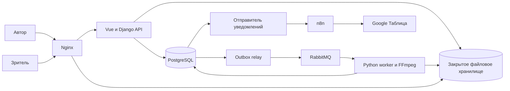

# VidHarbor — архитектура

**Статус** · Пакет DEC-003 принят пользователем. Документальная Architecture Review выполнена, Gate 3 открыт до разрешения блокирующих пунктов §11.
**Основание** · [Product Spec 0.3](../product-spec.md), [DEC-001–004](decision-log.md), каноническое ДЗ №005 ред. 2 и практическое ТЗ.
**Дата** · 2026-11-10. Технические решения с пометкой «кандидат» ещё требуют проверки.

## 1. Introduction & Goals

VidHarbor — учебный публичный видеокаталог. Автор загружает исходник из личного кабинета и получает ссылку после фоновой обработки. Зритель находит видео по названию и смотрит без входа. Готовность отдельно доставляется через n8n в Google Таблицу. Основные цели качества — отзывчивость при больших файлах, сохранность оригинала, объяснимые сбои, быстрый отзыв старых ссылок, воспроизводимое восстановление.

Заинтересованные стороны — автор, зритель, владелец продукта, оператор учебной среды и ментор. В Project 2 демонстрируются очереди, внешняя интеграция и отказоустойчивость. CP4/CP5 и весь Homework требуют отдельных доказательств.

## 2. Constraints

| Источник | Обязательство |
|---|---|
| EXTERNAL | M01–M12: веб-загрузка, сохранение оригинала, большой файл, несколько качеств до 720p, одна ссылка, вебхук и RabbitMQ. M13: реальная DLQ, Core по контексту встречи. |
| EXTERNAL | Q01–Q10 и F01–F14/F16–F18 — внутренние критерии из ТЗ. P01–P13 — проверка 11 письменных пунктов Production Practice. |
| USER_APPROVED | DEC-003, FR/NFR/AC из PRD: Vue/TS, Django/DRF, PostgreSQL, 5 ГиБ, повторы загрузки с начала, HLS, поздний ack, единый staging, фиксированная строка Sheets. |
| DERIVED | Для выбранного поведения нужны раздельные состояния, проверка владельца на сервере, контроль конкурентной записи, атомарные локальные переходы и процедуры сверки. |
| AI_PROPOSAL | Конкретные клиент RabbitMQ, топология, протокол lock, технические таймауты и настройки логирования ниже — кандидаты. |
| OPTIONAL | Объектное хранилище, CDN, внешнее размещение и аппаратное ускорение. |

Функциональность KazanCourts, общая теория Level 5 A/B/C и формальный Review 01 ведутся отдельно. Обязательная эксплуатационная практика обоих приложений сохраняется.

## 3. Context & Scope

Браузер обращается к одному origin. Страница `/videos/{id}` предназначена зрителю. Технический `/media/{id}/master.m3u8` предназначен плееру и webhook. Пути иллюстративны. Абсолютная ссылка строится из настроенного публичного адреса. Для локальной демонстрации документируется доступность с нужного компьютера, а не внешний адрес по умолчанию.

## 4. Solution Strategy

Компоненты приложения разделяют длительную передачу, вычисления, раздачу и доставку вебхука. PostgreSQL хранит состояния и outbox, RabbitMQ переносит команды, видео лежит на файловом томе. Приложение авторизует доступ к опубликованным файлам, Nginx раздаёт байты. Один worker преобразует одно видео одновременно. Сравнение альтернатив и причин выбора — в [DEC-001–004](decision-log.md).

| Компонент / задача | Технология | Почему нужна | Требования | Альтернатива | Деньги / ресурсы | Риски | Статус |
|---|---|---|---|---|---|---|---|
| Кабинет и каталог | Vue + TypeScript, Vite-кандидат | Загрузка, прогресс, публичный UI | FR-001/002/005/006/009 | Django templates, React | Отдельная сборка, RAM сборки и тестов | Больше клиентских зависимостей | YES |
| API и вход | Django + DRF, сессии, CSRF и проверка владельца | Бизнес-правила, операции автора | FR-001/008/010 | FastAPI, OIDC, JWT | Один сервис, БД сессий | Пропущенная проверка объекта | YES |
| Данные и поиск | PostgreSQL, пагинация, поиск по названию | Метаданные, транзакции и outbox | FR-003/005, NFR-003/007 | SQL FTS или отдельный поисковик при росте | RAM и диск, копии | Индекс и нагрузку измерить | MANDATORY |
| HTTP и media | Nginx, hls.js | Один origin и отзыв доступа к сегментам | FR-006–008 | Выдача из Django, другой HLS-плеер | Трафик по битрейту и зрителям | Доступность БД, кеш | YES |
| Видео и исходники | Локальный Docker volume, FFmpeg/ffprobe, HLS VOD | Оригинал, лестница вариантов, раздача | FR-002–004/007 | S3, tus, GStreamer, GPU | SSD и CPU, копия на другом носителе | Переполнение и общий отказ | YES |
| Очередь и фон | RabbitMQ, Python worker, Pika-кандидат, SQL outbox | Фоновое выполнение, повторы и DLQ | NFR-002/003, M07/M12/M13, Q01–05/Q08–10 | Celery, ранний ack, broker delay | Дополнительные процессы и диск | Гонки, timeout, дубли | MANDATORY для RabbitMQ/DLQ, остальное DEC-003 |
| Webhook | n8n и Google Sheets | Запись после публикации | FR-011/012, Q06/Q07 | Локальный n8n после согласования, append | Сеть и квоты, доступ к учётке | Потеря ответа и конфликт строки | YES, установка OPEN |
| Запуск | Docker Compose, environment, файлы secrets | Воспроизводимый локальный запуск | P01–P05 | Размещение на внешнем хосте позже | Ресурсы Docker VM | Недоступный engine, ограниченная RAM | MANDATORY |
| Наблюдение | JSON logs, Prometheus, Grafana, OpenTelemetry, Tempo | Диагностика и сквозной trace | P06–P10 | Jaeger вместо Tempo | RAM и диск, ограниченный retention | Шум метрик и утечки в логах | YES |
| Резервирование | pg_dump/pg_restore и отдельная копия медиа | Проверяемое восстановление | P11–P13 | Снимки и WAL/PITR при иных целях | Другой носитель и время окна | Устаревшие удаления и таблица | MANDATORY для доказательства |
| Тесты и CI | pytest, Playwright, настоящие RabbitMQ/PostgreSQL, GitHub Actions | Доказать поведение и совместимость | AC-001–009, F | Локальный CI, другой runner | Минуты CI, малые fixtures | Моки не доказывают доставку | YES в плане |

## 5. Building Block View

| Блок | Вход → результат | Данные и отказ |
|---|---|---|
| Vue / Django API | Сессия, команды автора и GET зрителя → состояние или разрешённая выдача | Пользователи, видео, каталог. При отказе БД защищённые операции закрываются. |
| Приём загрузки | Поток байтов → подтверждённый размер и неизменяемый оригинал | Временный файл и SHA-256. Обрыв оставляет незавершённую загрузку. |
| БД / relay | Commit и outbox → опубликованная команда с confirm | Задание, номер запуска, события, повторы и tombstones. При отказе брокера outbox накапливается с сигналом об отставании. |
| RabbitMQ / worker | ID задания → готовые варианты или причина ошибки | Байты читаются с тома. Отказ worker оставляет неподтверждённую команду и историю попытки. |
| Файловый том | Оригинал → staging → готовая версия | Закрытый доступ. База хранит ключи, контрольные суммы и статусы. Потеря диска восстанавливается отдельной копией. |
| Notifier / n8n | Снимок публикации → запись строки и подтверждение | Независимая история доставки. Сбой получателя сохраняет опубликованный ролик. |
| Telemetry / backup | События, метрики, трассы и снимок → диагностика и восстановление | Объём ограничивается. Отказ telemetry наблюдается отдельно от доступности каталога. |

Сущности: `Video`, `Upload`, `Job`, `Attempt`, `Outbox`, `Delivery`, `Deletion`. Уникальны `job_id + generation + attempt_no`, `message_id`, `event_id` и выделенная строка на лист. `Video` хранит владельца и актуальное поколение. Один том содержит `original`, `processing`, `ready` и стабильные lock-файлы в закрытом каталоге. База данных, брокер и диагностика имеют собственные тома.

## 6. Runtime View

1. Автор создаёт загрузку с названием и размером. Отдельный HTTP-путь принимает непрерывный поток в закрытый `.part`. Предел 5368709120 байт проверяется по объявленному размеру и фактическим байтам. Клиент показывает прогресс передачи, затем ожидание проверки. API и каталог обслуживаются отдельным пулом. Настроить потоковый проход Nginx и сервера без второй полной временной копии. По ходу записи считаются длина и хэш. Завершение фиксирует оригинал и атомарно в БД создаёт задание с outbox. Обрыв требует начать заново. Уборка старше 24 часов требует отсутствия активной передачи и её lock.
2. Relay публикует команду в RabbitMQ. Worker проверяет поколение, берёт право на обработку и устойчиво учитывает попытку. FFmpeg работает в отдельной группе процессов. Успех требует полной проверки HLS, переноса `processing → ready` на одном томе и commit статуса `READY`. Только после commit идёт ack. Полная схема при crash, retry и DLQ — в [reliability](reliability.md).
3. Для горизонтали целевые рамки 640×360, 854×480, 1280×720. Для портретного кадра — повёрнутые рамки как принятая цель пользователя, ограничение M06/U02 проверить до фиксации теста. Поворот/пропорции нормализуются до выбора лестницы. Ступени, требующие увеличения, пропускаются. Для малого файла допустим один вариант фактического размера, без фиктивной метки 360p. Из контейнеров MP4/MOV/MKV/WebM проверяются реально поддерживаемые потоки. Аудио при наличии конвертируется в AAC, видео в H.264, сегменты согласованы по ключевым кадрам. Chrome/Edge/Firefox desktop проверяют Auto и ручной выбор.
4. Готовое видео автоматически видно в каталоге, поиск по названию регистронезависимый. Переименование меняет запись, ссылка остаётся. Проверка доступа к каждому публичному media URL разрешает только актуальную готовую версию, после чего Nginx раздаёт файл через внутренний location. Новые запросы к удалённому видео получают 404. Без долгого кеша на первом запуске.
5. Удаление блокирует публичную выдачу и новые запуски сразу, отзывает поколение, отменяет ожидающую доставку и планирует повторяемую очистку. Worker останавливается, уборщик получает файловый lock. Уже переданные клиенту байты и ранее записанная строка остаются. Контракт Sheets и гонки описаны в [reliability](reliability.md).

## 7. Deployment View

Compose: Nginx, Django web и отдельный пул upload, PostgreSQL, RabbitMQ, worker, relay/notifier, Prometheus, Grafana и Tempo. Vue собирается в статические файлы. n8n используется существующий после подтверждения доступа. Рабочий, тестовый и restore-профили используют разные данные, адреса и секреты. Служебные порты доступны только внутри Compose или с локального интерфейса по необходимости.

Фактическая локальная инвентаризация 2026-11-10: Asus, Windows 11 Pro 25H2, 8 логических CPU, 15,7 ГиБ установленной RAM, около 2,9 ГиБ доступной RAM на момент осмотра и 21,2 ГиБ свободно на системном диске. Docker CLI 29.2.0 и Compose v5.0.2 доступны. Linux engine не отвечал. Доступные контейнерам CPU/RAM, файловые свойства тома и местоположение Docker-данных ещё нужно измерить.

Стартовая гипотеза для проверки после освобождения ресурсов — 1 активная загрузка и 1 FFmpeg, worker до 2 CPU и около 2–3 ГиБ RAM, telemetry с коротким retention. Для большого демо предварительно нужен бюджет под 5 ГиБ оригинала, ещё до 5 ГиБ параллельной передачи при одновременном сценарии, staging/ready, существующую библиотеку, Docker/БД/telemetry, и запас. При сумме битрейтов 5,4 Мбит/с час всех вариантов займёт около 2,4 GB плюс накладные расходы. Для рабочего профиля ориентир 30 ГиБ свободно на фактическом диске томов, отдельный объём для копии и restore. Это оценки, не измерения. Если рабочего места мало, приём и попытка должны предсказуемо отказать. Производительность проверяется на согласованном файле 3–5 ГБ, включая время передачи, RSS, объём файла, CPU, I/O и задержку каталога.

## 8. Crosscutting Concepts

- **Конфигурация:** документировать адреса, лимиты, состояние диска, timeout, retry и retention. Пароли, Django secret, webhook secret и Google credentials — вне Git, образов и логов. Служебные ACL и разные роли для API/worker/relay.
- **Безопасность:** same-origin, Secure/HttpOnly cookie при HTTPS, CSRF для действий и входа, проверка владельца по объекту, ограничение частоты и байтов. Пути только из внутренних ID. Worker непривилегирован, читает локальные медиа и ограничивает ресурсы декодирования. Внешний webhook по HTTPS.
- **Health/readiness:** liveness процесса независимо от внешних зависимостей. Readiness web проверяет БД, upload — путь записи и запас места, worker — БД, брокер и хранилище. При отказе RabbitMQ каталог работает, при отказе n8n готовые видео продолжают воспроизводиться. Отдельно сигнализировать возраст outbox и глубину DLQ.
- **Наблюдение:** JSON-логи с request/job/event/trace ID без секретов, OpenTelemetry через HTTP, outbox, AMQP и worker, Prometheus с длительностью/ошибками/глубиной, Grafana и Tempo для одного полного сценария. Ограничить размер и число файлов логов, ограничить retention диагностики. Предварительные цифры хранения утверждаются по ресурсу в S07.
- **Копии:** пауза изменений, согласованный pg_dump и manifest медиа, копия отдельно от рабочего носителя. Restore PostgreSQL в чистую БД, сверка схемы/связей, возврат медиа по хэшам, воспроизведение и проверка старых ссылок. Перед открытием выдачи применить журнал удалений после backup. Отправку n8n держать выключенной до сверки выделенных строк. RPO/RTO и место хранения согласовать в S08.

## 9. Architecture Decisions

[DEC-001–004](decision-log.md) фиксируют YES/NO/OPEN/MANDATORY, цену выбора и условия пересмотра. Vue и Django/DRF выбраны ради разделения клиентской практики и знакомого сервера. Локальное хранение и повтор с нуля уменьшают объём системы, увеличивают стоимость прерывания большой передачи. Поздний ack оставляет ответственность за доставку у брокера, но требует живого канала, времени обработки меньше таймаута и файловой защиты от одновременных писателей. Transactional Outbox убирает окно утраты обязательства при сбое между БД и publish ценой relay, истории и дубликатов. Внешний сервис и Sheets не входят в атомарный commit.

Кандидаты версий для первого согласованного этапа:

| Группа | Документальный базис | Что закрепить после разрешения S01 |
|---|---|---|
| Backend | Python 3.13, Django 5.2 LTS, DRF 3.16+, PostgreSQL 17, psycopg 3. Django 5.2 поддерживает PostgreSQL 14+ и DRF 3.16 объявляет поддержку Django 5.2/Python 3.13. | Выбрать поддерживаемые patch-релизы с учётом security, записать exact pins, прогнать миграции и smoke. [DRF 3.16](https://www.django-rest-framework.org/community/3.16-announcement/), [Django и PostgreSQL](https://docs.djangoproject.com/en/5.2/ref/databases/). |
| Frontend | Node 24 LTS, Vue 3, TypeScript и сборка Vite. hls.js 1.x. | Сверить `engines`, закрепить lockfile, браузеры Playwright и сборку. [Node releases](https://nodejs.org/en/about/previous-releases), [Vite](https://vite.dev/guide/), [hls.js](https://github.com/video-dev/hls.js). |
| AMQP | RabbitMQ 4.x с поддерживаемыми quorum, ack timeout и выбранной DLX policy. Pika AMQP 0-9-1. | Точный tag/digest и версия Pika после проверки актуальной поддержки. Доказать ack timeout, подтверждения и poison DLX на фактическом образе. [RabbitMQ quorum](https://www.rabbitmq.com/docs/quorum-queues), [Pika](https://pika.readthedocs.io/). |
| Media, edge и telemetry | Доступный поддерживаемый образ Linux/Nginx, FFmpeg с H.264/AAC, Prometheus/Grafana и Tempo с OTLP. | Закрепить образы по версиям/digest, проверить наличие кодеков, внутреннюю выдачу и сквозной trace. [FFmpeg formats](https://ffmpeg.org/ffmpeg-formats.html), [OTLP](https://opentelemetry.io/docs/specs/otlp/). |

Это проверка совместимости по документации. Реальные pins, сборки и тесты относятся к S01 и последующим этапам. Образы с плавающим `latest` в воспроизводимом запуске не используются.

## 10. Quality Requirements

[RTM](requirements-traceability.md) связывает все требования с будущей проверкой. Приёмка требует двух аккаунтов и запрета чужих действий, исходника 3–5 ГБ, воспроизведения всех допустимых качеств в трёх desktop-браузерах, безопасного удаления во время обработки, реальных RabbitMQ/DLQ и восстановления после отказов. Отдельно показать строку n8n/Sheets и потерянный ответ без дубля, живой dashboard, trace и чистое восстановление данных и медиа. Ни один результат приложения пока не измерен.

## 11. Risks & Technical Debt

| OPEN | Последствие | Владелец и закрытие |
|---|---|---|
| OPEN-02/U02 · предел вертикального видео | 720×1280 может конфликтовать со строгой высотой 720 px | Пользователь уточняет у ментора до S04 и окончательного AC-003. При конфликте минимальное изменение — ограничить высоту вертикального результата. |
| OPEN-03 · Docker и запас ресурсов | Нельзя подтвердить допуски среды и обещать полноразмерное демо | Оператор освобождает RAM/SSD и обеспечивает доступ Linux engine. В разрешённой диагностике проверить бюджет, поддерживаемые образы и фактический том. |
| R-LOCK · старый FFmpeg | Общая папка может быть испорчена, если потомок переживёт worker | Разработчик доказывает наследование lock, завершение группы и восстановление по manifest на реальном томе до основной S03/S04. При провале представить минимальное изменение DEC-003. |
| R-ACK · длительность и DLX | Задача будет повторно доставлена при закрытии канала | Разработчик проверяет heartbeat и timeout с укороченными параметрами, три попытки и реальную DLQ. Выбрать бюджет до большого прогона. |
| OPEN-01 · n8n | Неизвестны доступность установки, права и доступность ссылки | Пользователь/оператор подтверждает установку и учебную вкладку до S06. |
| OPEN-04 · restore | Восстановление старой копии может открыть удалённый файл или конфликтную строку | Оператор согласует отдельный журнал удалений, хранение, носитель, RPO/RTO и проверку до S08. |

Gate 3 не закрыт по вертикальному ограничению и технической осуществимости в среде. Проект плана остаётся Draft для Gate 4. Эти статусы не меняют согласование DEC-003.

## 12. Glossary

- **Оригинал** — подтверждённый неизменяемый входной файл.
- **HLS master** — один плейлист со ссылками на доступные качества.
- **Outbox** — запись об обязательстве отправить сообщение, сохранённая в той же транзакции, что и состояние.
- **Confirm / ack** — подтверждение публикации брокером и подтверждение завершения работы потребителем.
- **DLX / DLQ** — exchange для маршрутизации отказов и отдельная очередь проблемных сообщений.
- **Поколение** — версия задания, которую можно отозвать при повторе или удалении.
- **Tombstone** — устойчивая запись, что публичное видео отозвано.
- **RPO / RTO** — допустимая потеря данных по времени и допустимое время восстановления.
