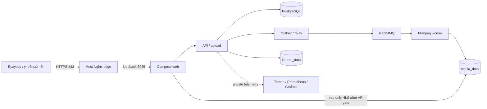

# Подготовка публичного учебного стенда

Статус: **offline preparation; deployment / DNS / публичный TLS Not Run**. Сервер, домен и провайдер не выбраны и не создавались. [HTTPS template](../../config/deployment/nginx-https.conf.example), [public env](../../config/deployment/public.env.example), [Compose overlay](../../config/deployment/compose.public.yaml.example), [Django overlay](../../config/deployment/public_settings.py) не включены стандартным запуском. Первые реальные команды на сервере требуют отдельного разрешения.



## Требуемые решения и ресурсы

Один Linux cloud host с Docker Engine/Compose v2 достаточен для учебного варианта; VPS — лишь один вариант, не обязательная покупка в этой задаче. PaaS должен поддерживать долгие FFmpeg jobs, большой persistent volume, stream upload, Rabbit/PostgreSQL и действующие quotas; GitHub-hosted runner — временный тестовый стенд, не постоянный public demo.

Планирование: сумма настроенных caps основного стека с одновременным migrate около2.66 GiB RAM/8.25 CPU quota (без migrate 2.47 GiB/7.25 CPU); telemetry добавляет 1408 MiB/2.5 CPU (включая изолированный metrics collector256 MiB/1 CPU). CPU quota не означает обязательное число физических ядер, но конкуренция увеличит время FFmpeg. Для первого отдельного стенда ориентир4 vCPU/8 GiB RAM и SSD с расчётом места ниже, **не согласованный заказ/гарантия**. Точные размеры и бюджет утверждаются после проверки выбранного хоста. В текущем managed Docker `cgroup driver=none`; cgroup enforcement, OOM behavior и время под caps не доказаны.

На каждом mountpoint требуется исходник(до5 GiB)+HLS+processing reserve+части других загрузок+PG/broker/journal+images/cache+telemetry+backup staging. Для restore одновременно нужен ещё полный комплект target volumes и bundle. Размер HLS зависит от длительности и bitrate, а не только от размера original: не обещать универсальные20/40GiB. Перед каждой большой проверкой `df -h`, `docker system df`, оценка длительности/лестницы и stop threshold с запасом; без места не начинать.

| Объект | Что должно быть утверждено / проверено |
|---|---|
| DNS | A на фактический IPv4 выбранного edge; AAAA только при реально работающем IPv6 listener/routing/firewall; текущий template содержит IPv4 listeners. TTL/переключение заранее, не менять DNS сейчас |
| Inbound |443 для сайта;80 для redirect/выбранного ACME способа; SSH только ограниченным операторам. Не открывать5432/5672/15672/4318/9100/13007/13207/13907/8085 |
| Edge | Host Nginx на том же хосте; 127.0.0.1:8085 upstream. Если другой хост/контейнер — этот template неприменим без отдельной network-схемы |
| TLS | Настоящий сертификат/fullchain/key и renewal с reload; private key вне Git. DNS/HTTP challenge и CA ещё не выбраны |
| Data |postgres_data,rabbitmq_data,media_data,journal_data; не подключать original к edge, не удалять lock inode. Web имеет media read-only с API gate; telemetry volumes отдельно |
| Secrets |django_secret_key,postgres_password,rabbitmq_password; optional telemetry_metrics_token,grafana_admin_password; webhook_secret только после согласования. Private directory/backup encryption/доступ/ротация отдельно |
| Observability |loopback UI через SSH tunnel; metrics bearer внутри сети; retention/log bounds из operations; внешних alert receivers нет |
| Restart/fencing |Одна активная source-система; никакого автоматического запуска старого source после restore. Docker restart policies и migrate учитывать по S08 runbook |

## Подстановка и проверка до запуска

Стандартный Django разрешает только localhost/127.0.0.1. Одного DNS/PUBLIC_BASE_URL недостаточно: публичные Host и HTTPS CSRF иначе не готовы. Поэтому подготовлен **отключённый** settings overlay, разрешающий ровно один lowercase DNS hostname, HTTPS trusted origin и secure cookies. Он отвергает wildcard/URL/placeholder. Public Compose template монтирует его только API/upload. Edge всегда перезаписывает `X-Forwarded-Proto: https`; web сохраняет заголовок до Django. Доверие proxy безопасно лишь при закрытом loopback upstream, который клиенты не могут обойти. DB migrations/worker не требуют public settings.

В private копии env заменить все `__...__`, сохранить базовые DB/user параметры `.env.example`, задать правильный PUBLIC_BASE_URL **до создания нового READY event**. Прежние immutable события со старым loopback URL не переписывать. В host edge template заменить hostname/cert paths/loopback port согласованными значениями. Выполнить `nginx -t`, Compose config, проверить, что API/upload используют public_settings, secure cookies и точный CSRF origin, а все telemetry порты остаются loopback. Не печатать секреты или `docker compose config` с их значениями.

Offline `scripts/check_public_templates.py` проверяет Nginx синтаксис с временным синтетическим сертификатом, `--network none` и без ports. Отдельная проверка public settings валидирует точный hostname/CSRF/proxy flags и отказ некорректных имён. Это не выдача настоящего сертификата, не проверка renewal и не публичный HTTPS handshake.

## Первый запуск после разрешения

1. Закрепить прошедший Review SHA и образы, проверить Docker/Compose/cgroups/место/часы, firewall и независимую копию секретов. Не применять current development main по плавающему тегу.
2. В отдельном private env заполнить согласованные значения. Создать persistent volumes/права и только отсутствующие secret files; не менять credentials существующего PG/Rabbit.
3. Из корня репозитория проверить конфигурацию:

```bash
docker compose --env-file /private/public.env -f compose.yaml -f config/deployment/compose.public.yaml.example config --quiet
# Только после разрешения на конкретный стенд:
# docker compose --env-file /private/public.env -f compose.yaml -f config/deployment/compose.public.yaml.example up --build -d --wait --wait-timeout 240
```

4. Сначала localhost live/ready, миграции и внутренний API. Затем проверенный edge/TLS, HTTPS регистрация/login/CSRF secure cookies, новый маленький upload→queue→FFmpeg→watch. Notifier выключен.
5. Только после закрытых проверок открывать firewall/public DNS на согласованный endpoint; проверить извне отсутствие обхода внутренних путей/ports. Отдельно разрешить учебную интеграцию.

Команды с `#` намеренно не выполнены. Для telemetry добавить `-f compose.observability.yaml --profile observability` и два дополнительных secret files; после запуска проверить реальные limits/retention. `.example` с placeholders не является готовым production env.

## Обновление и rollback

До update закрыть запись, fence старые writers, сохранить SHA/images/config и **согласованный** bundle плюс актуальный deletion/reservation authority. Прогнать миграции на отдельной чистой копии, подтвердить совместимость. На обновляемом стенде только один migrate; затем live/ready, original hashes, HLS gate, Job/Outbox/Delivery, public CSRF/trace/panel. При провале оставлять публичный доступ закрытым.

S07 не добавляет миграций. Нельзя предполагать, что любой будущий rollback кода совместим с новой схемой. Допустим возврат старых образов лишь при доказанной совместимости; иначе clean restore в отдельные volumes по [backup-restore](backup-restore.md), свежий authority, сверка in-flight/Sheets, отдельное разрешение cutover. Никогда не восстанавливать старую БД поверх свежего журнала с его откатом и не делать `down -v` на стенде с данными. Старый source не возвращать параллельно target. DNS rollback сам по себе не возвращает данные.

## Публичная приёмка после доступа

- [ ] SHA, рабочий HTTPS/fullchain/renewal, domain→edge, закрытые внутренние порты, точные Host/CSRF и secure cookies.
- [ ] Настоящие `docker info` cgroup driver и `docker inspect` caps, cgroup memory.max/cpu.max, базовые RSS/CPU/disk; остановить прогон при исчерпании бюджета, не отключать caps ради PASS.
- [ ] Два автора: права/CSRF; небольшой файл и затем согласованный валидный3–5 GB в пределах5 GiB. Происхождение, bytes/SHA, upload/probe/queue/encode/READY/player times, max RSS/CPU/disk, отзывчивость каталога; обычный UI/upload/Rabbit/FFmpeg, Auto/каждое качество. Обрыв/повтор, превышение лимита на малом fixture.
- [ ] Публичные watch/master/segments, удаление/FFmpeg/повтор delete/cleanup restart и сохранность оригинала при retry. Исторические локальные доказательства не подменяют внешнюю приёмку.
- [ ] Trace по новому upload, метрики success/failure/recovery и реальная панель; неисправности только на отдельном тестовом project, не на production.
- [ ] n8n/Sheets сценарии из [integration-rehearsal](integration-rehearsal.md); отдельное согласование notifier.
- [ ] Независимый backup carrier/current authority, clean restore и host-loss recovery, утверждённые RPO/RTO/retention. Финальный RTM, independent Review, Defense/ментор отдельно.

Ранее3,529,596,888 bytes успешно прошли учебный local UI→Rabbit→FFmpeg→player и clean restore; повтор этого тяжёлого drill сейчас не выполнялся. Под действующими server CPU/RAM caps и публичным HTTPS этот сценарий ещё Not Run.
